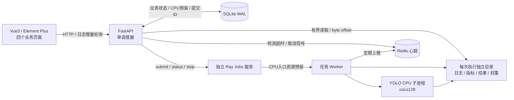
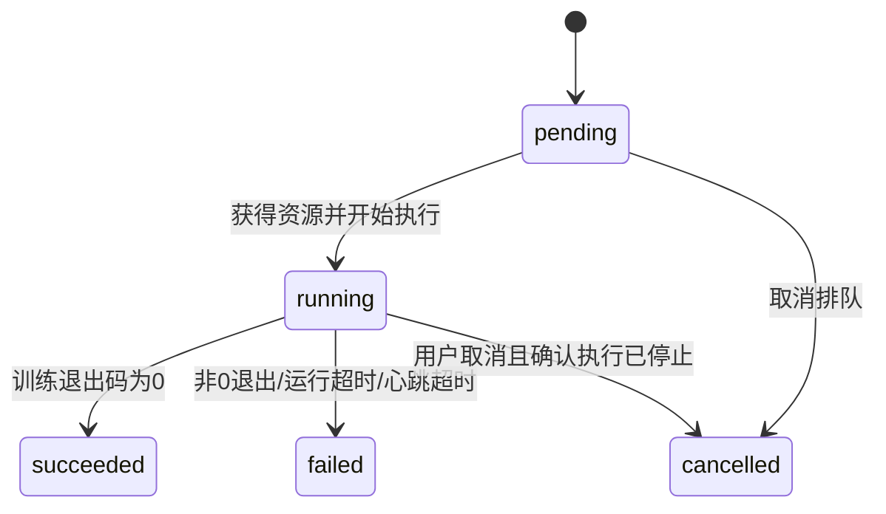

# TrainPlane · 轻量 CPU 训练平台

面向单机、可信本地用户的前后端分离训练平台。使用真实 Ray Jobs 执行任务、Redis 接收 worker 心跳、SQLite 保存任务与资源预留；默认负载为 ultralytics YOLO + coco128 + CPU。平台自行实现业务页面、队列、状态机、日志和恢复逻辑，不嵌入第三方平台页面。

GitHub 仓库：[jackjiahao1491/trainplane-yolo-cpu](https://github.com/jackjiahao1491/trainplane-yolo-cpu)。

完整架构流程图、所有功能的实现说明、代码入口、验收证据和优化建议见 [架构与功能实现说明](docs/architecture-and-implementation.md)。需要离线展示或打印时，可下载 [HTML阅读版](docs/architecture-and-implementation.html) 后在浏览器中打开；图表不依赖网络。

## 技术栈与运行边界

- 后端：Python 3.12、FastAPI、Ray、redis-py、SQLite、psutil。
- 前端：Vue 3、Vite、TypeScript、Element Plus。
- 训练：ultralytics、CPU 版 PyTorch、`yolov8n.pt`、`coco128.yaml`。
- 默认运行方案：Windows运行前端与Docker Desktop，Linux容器运行FastAPI、Ray、YOLO和真正的Redis 7.4。仍是在本机CPU执行，不需要Linux双系统或GPU。
- 单节点、单个 API 调度进程。使用文件锁拒绝多个调度器管理同一数据目录；运行 API 时不要加 `--reload` 或多个 worker。
- 默认开放 2 个 CPU 调度配额，每个真实训练申请 2 个，避免 8GB 内存机器同时启动多个训练。申请 1 核的小测试任务可并发执行。
- 平台CPU配额用于调度预留，训练入口同步限制PyTorch、OMP、MKL线程数，并在Ultralytics训练/验证回调中恢复配额。Docker还为Ray容器设置与总配额一致的CPU时间上限；它不等于将任务绑定到指定物理核。
- API、前端、Redis、Ray Dashboard的宿主端口只暴露给本机。命令输入会执行训练环境中的进程，供面试演示的可信用户使用；不是面向公网的多租户沙箱。

原生Windows上的Ray虽然曾通过短任务、并发和API重启检查，但多轮执行后仍出现GCS键值写入请求挂起，不能据此声称原生方案稳定通过。默认交付改为Docker Linux后端；Docker的最终实测与尚未验证项分别记录在 [验收记录](docs/verification.md)。

## 架构



SQLite 是业务元数据的持久化事实来源，Ray 表示执行器真实状态，Redis 是短期心跳与取消信号。CPU 占用来自未释放的 SQLite 预留，不能用机器瞬时 CPU 使用率代替。

默认Compose中，API与Ray使用同一镜像和相同 `/app` 路径，挂载同一份 `backend/data`。API通过 `pid: service:ray` 共享Ray的PID命名空间，因此能核对并终止训练进程树；只重启API不会停止Ray中的训练。容器里的节点CPU/内存统计反映Docker Linux环境，资源配额卡片仍以平台配置为准。

## 安装依赖

建议将项目与 Python 环境放在 D 盘。需要 Python 3.12、Node.js（支持当前 Vite 的版本）、npm、Git、已启动的 Docker Desktop（Linux containers）。首次下载 PyTorch、YOLO 权重与 coco128 需要网络。

在项目根目录的 PowerShell 中执行：

```powershell
.\scripts\setup.ps1
Copy-Item .env.example .env
# 首次启动前准备只读挂载的模型文件及数据集；本机网络使用镜像传输。
backend\.venv\Scripts\python.exe scripts\prepare_training.py --mirror
```

默认安装脚本只在宿主Python虚拟环境安装预缓存与验收所需的requests、psutil，并运行前端 `npm ci`；训练依赖由Docker镜像安装，避免新机器在Windows和Linux重复安装两套PyTorch。pip显式使用项目 `.cache/pip` 缓存。只有 `setup.ps1 -Native` 才读取 `backend/requirements.lock.txt` 安装全量Windows依赖。Linux完整依赖快照另存于 `backend/requirements-linux.lock.txt`，Dockerfile从固定核心版本的 `backend/requirements.txt` 构建。

如本机脚本执行策略禁止 `.ps1`，可仅对当前 PowerShell 窗口执行 `Set-ExecutionPolicy -Scope Process Bypass`，然后继续。无需更改机器全局策略。

## 启动与停止

在项目根目录执行：

```powershell
.\scripts\start-docker.ps1 -Build
```

首次加 `-Build` 构建后端镜像；之后可直接运行 `start-docker.ps1`。脚本仅启动本项目Compose的Redis、Ray、API和宿主Vite，等待依赖健康后提供页面。Vite后台窗口隐藏，其日志与进程归属记录写入 `.runtime/`；后端日志使用 `docker compose logs -f api ray` 查看。

- 页面：<http://127.0.0.1:5173>
- Swagger：<http://127.0.0.1:8000/docs>
- 健康检查：<http://127.0.0.1:8000/api/health>
- Ray Dashboard：<http://127.0.0.1:8265>（诊断入口，业务界面自行实现）

健康检查 `status=ok` 且 `ray_ok`、`redis_ok` 为 true 后再提交任务。`degraded` 表示API已启动，但依赖连接或调度操作仍有异常；前端仍可查看历史任务。

```powershell
# 只重启 API 容器：保留 Ray、Redis和训练进程。
.\scripts\start-docker.ps1 -ApiOnly

# 停止本项目API、Ray和脚本创建的前端，保留Redis和所有数据。
.\scripts\stop-docker.ps1
# 如还要停止项目 Redis（保留数据卷）：
.\scripts\stop-docker.ps1 -StopRedis
```

停止完整平台会停止Ray执行服务和训练。要观察后端重启后的任务接管，应使用 `start-docker.ps1 -ApiOnly`。脚本不会停止其他Compose项目或删除数据卷；宿主前端仅按清单中的PID和启动时间停止。

## 可选：原生Windows后端（兼容性排查用）

默认Docker方案和原生后端会使用相同8000/8265端口，不应同时启动。原生方案在本机多轮执行后不稳定，保留脚本便于复现实测和排查，不作为稳定演示推荐。若仅需复现原生路径：

```powershell
.\scripts\setup.ps1 -Native
.\scripts\start.ps1
# 仅重启原生API：
.\scripts\stop.ps1 -ApiOnly
.\scripts\start.ps1 -ApiOnly
# 仅停止脚本持有的原生进程：
.\scripts\stop.ps1
```

若手动启动，使用三个独立终端（另用 Docker 启动 Redis）：

```powershell
docker compose up -d --wait redis
# 终端 1，backend 目录：Ray端口6380与Redis端口6379分离。
$env:CUDA_VISIBLE_DEVICES = '-1'
$env:RAY_USE_OLD_GCS_CLIENT = '1'
.venv\Scripts\ray.exe start --head --block --num-cpus=2 --num-gpus=0 --port=6380 --dashboard-host=127.0.0.1 --dashboard-port=8265 --object-store-memory=83886080 --disable-usage-stats --temp-dir=D:\ray-trainplane
# 终端 2，backend 目录：
.venv\Scripts\python.exe -m uvicorn app.main:app --host 127.0.0.1 --port 8000 --workers 1
# 终端 3，frontend 目录：
npm.cmd run dev -- --host 127.0.0.1 --port 5173 --strictPort
```

`.env` 由 `start.ps1` 读取；手动启动时请自行在终端设置环境变量。可配置项见 [.env.example](.env.example)。

Windows下Ray使用ASCII临时路径，脚本默认在项目盘符下的 `ray-trainplane` 目录（本机为 `D:\ray-trainplane`），避免中文路径兼容问题。该目录是Ray运行期文件，业务持久化仍位于 `backend/data`。脚本不会递归删除此目录。

原生脚本锁定Ray 2.40.0，并设置 `RAY_USE_OLD_GCS_CLIENT=1` 尝试该版本提供的旧GCS客户端兼容路径；该措施仍未解决多轮执行挂起，因此转用Docker后端。未修改第三方源码。

下表是原生环境变量默认值。Docker内部Redis/Ray地址和挂载路径以 `compose.yaml` 为准；Compose读取 `.env` 中的 `TOTAL_CPUS`、心跳与调度间隔设置，并自动将CPU总配额同步到API、Ray逻辑资源和Ray容器CPU时间上限。

| 配置 | 默认值 | 含义 |
|---|---|---|
| `TOTAL_CPUS` | `2` | 平台可分配核数，应与专用 Ray 节点 `--num-cpus` 保持一致 |
| `REDIS_URL` | `redis://127.0.0.1:6379/0` | 心跳与取消信号服务 |
| `RAY_ADDRESS` | `http://127.0.0.1:8265` | Ray Jobs HTTP 地址 |
| `TRAINPLANE_DATA_DIR` | `backend/data` | 元数据与任务文件根目录，改动后视为另一套数据 |
| `HEARTBEAT_TIMEOUT` | `15` 秒 | 已收到过心跳后允许的最大间隔 |
| `HEARTBEAT_STARTUP_GRACE` | `90` 秒 | Worker 初始化、首次心跳的宽限期 |
| `SCHEDULER_INTERVAL` | `1` 秒 | 调度/核对周期 |

## 提交真实 YOLO 任务

进入“提交任务”，保留默认命令，设置名称、CPU 配额与最大运行时间后提交：

```text
python -m app.train --epochs 1 --imgsz 320 --batch 1
```

现场演示前可在项目根目录预缓存官方模型权重和coco128，减少首次下载对演示的影响：

```powershell
backend\.venv\Scripts\python.exe scripts\prepare_training.py
# 本机GitHub下载较慢时：
backend\.venv\Scripts\python.exe scripts\prepare_training.py --mirror
```

默认模型传输源为Ultralytics的GitHub资产仓库；`--mirror` 使用第三方 `hf-mirror.com` 传输模型，并验证其SHA256与 [Ultralytics官方Hugging Face模型文件](https://huggingface.co/Ultralytics/YOLOv8/blob/main/yolov8n.pt) 一致：`31e20dde3def09e2cf938c7be6fe23d9150bbbe503982af13345706515f2ef95`。镜像不是官方托管站点。coco128从 [Ultralytics官方Kaggle数据集](https://www.kaggle.com/datasets/ultralytics/coco128) 接口下载，解压检查路径并确认128张图片。来源、大小与文件摘要写入 `docs/training-assets.json`。

Windows预缓存脚本还会将本机Arial字体复制到被Git忽略的运行数据目录，供Ultralytics使用，避免首次训练临时下载字体；字体文件不会进入仓库。

该入口固定 `device=cpu`、`data=coco128.yaml`、`workers=0`、`cache=False`，默认 nano 模型。首次会下载权重与数据集，之后可在本机缓存中复用；数据集路径固定在 `backend/data/datasets`，不依赖用户全局Ultralytics路径配置。它执行真实训练与验证，不追求短时间得到高精度模型；不使用 GPU、NCCL 或 DDP。

这台8GB电脑的训练验收期间，经用户授权临时停止了其他15个Docker应用容器以释放资源；记录的耗时不代表所有原有应用同时运行时的性能。演示前应保留足够可用内存，默认只同时执行一个真实训练。

最终线程配额修正版已在本机Docker完成一次真实训练：任务 `993c67aa8de849fa`，1 epoch、320图片尺寸、batch1、2核配额，用时107.378秒，退出码0；训练/验证四次检查均为2线程，日志未再次下载资产，生成best.pt与last.pt并释放CPU。原始证据见 [yolo-results.json](docs/yolo-results.json)。此耗时是本机这次运行结果，不是对其他机器的承诺。

打开详情可查看训练日志、退出码、失败原因和每轮指标。权重留在任务执行目录的 `artifacts/train/weights/`，本题 P0 不要求权重下载 API。

## 状态、调度与恢复



- 先按优先级降序，再按创建时间 FIFO 排队；同优先级顺序稳定。队首资源不足时等待，不做回填和抢占，避免大任务被后续小任务持续绕过。
- 在 SQLite 事务内预留 CPU、持久化固定 Ray submission ID，然后提交。外部提交结果不确定时保留预留并核对同一 ID，避免重复启动。
- 任务 `running` 后，训练子进程实际启动时间用于计算最大运行时长；排队时间不计入运行超时。
- 取消运行任务先记录 `stop_reason`、发送Redis取消信号，给worker短暂收尾宽限；若仍存活则强制终止训练进程树并停止Ray任务。确认Ray终态、已记录的本地进程停止后，才释放CPU。停止期间可能仍显示 `running`。
- 任务正常退出码为 0 才标记成功；非零退出、超时、失联都标记失败并记录原因；用户取消标记 cancelled。
- Worker 每 2 秒上报 Redis 心跳。Redis 临时断连不等于所有 worker 死亡，平台保留资源并暂停新调度；运行超时仍有执行侧兜底。
- API 重启后先核对所有未释放预留的 Ray Job，再调度新任务。Ray 暂时不可达时不把占用当作空闲；Ray 明确已丢失的既有任务会失败收尾，不自动重跑。
- Ray 服务本身重启不保证训练续训；这里恢复的是平台记录、资源账本和管理能力，不是模型断点续训。

## 接口

所有接口前缀为 `/api`，错误响应使用 FastAPI 的 `detail`。完整参数定义可直接查看 Swagger。

| 方法 | 路径 | 用途 |
|---|---|---|
| GET | `/health` | Ray/Redis 连接状态 |
| GET | `/cluster` | 配额、排队/运行计数、节点实际 CPU/内存使用率 |
| POST | `/jobs` | 提交任务，返回 201 和任务对象 |
| GET | `/jobs?page=1&page_size=10&status=running&search=任务ID` | 分页、状态筛选、ID 子串搜索 |
| GET | `/jobs/{id}` | 任务详情，含退出码、失败原因、停止原因、执行ID |
| POST | `/jobs/{id}/cancel` | 幂等取消；终态任务保持原状态 |
| GET | `/jobs/{id}/logs?offset=0&limit=65536` | 从字节位置读取有限长度日志 |
| GET | `/jobs/{id}/metrics` | 每轮 loss、mAP 等指标 |

提交示例：

```powershell
$Body = @{
    name = 'YOLO CPU 演示'
    command = 'python -m app.train --epochs 1 --imgsz 320 --batch 1'
    cpu = 2
    timeout_seconds = 1800
    priority = 0
} | ConvertTo-Json
Invoke-RestMethod -Method Post -Uri http://127.0.0.1:8000/api/jobs -ContentType 'application/json; charset=utf-8' -Body ([Text.Encoding]::UTF8.GetBytes($Body))
```

`cpu` 为正整数且不能超过平台总配额；`priority` 范围 0～10；`timeout_seconds` 范围 1～86400。不存在的任务返回 404，非法参数返回 422。

增量日志返回示例：

```json
{"content":"[demo] started\n", "next_offset":15, "eof":true, "finished":false}
```

`offset` 和 `next_offset` 是文件字节位置，不是字符数量。`limit` 为 4～1048576 字节；服务端避免在 UTF-8 字符中间截断。前端始终使用返回的 `next_offset`，不能自行按 JS 字符串长度递增。`eof=true` 只表示读到当前文件末尾，仍在运行时后面可能有新日志；应同时参考 `finished`。请求位置超过现有文件大小返回 416。日志按纯文本渲染，训练输出中的 HTML 不会执行。

## 验收与演示

平台空闲时，从项目根目录运行：

```powershell
backend\.venv\Scripts\python.exe scripts\smoke.py
# 2核配额下：两个实际子进程并发、第三个排队、自动接续与无超配
backend\.venv\Scripts\python.exe scripts\concurrency.py
```

脚本通过真实 HTTP 接口创建带 `acceptance-` 前缀的短任务，覆盖排队、排队取消、运行取消、自动调度、正常/非零退出、运行超时、心跳超时、分页筛选、UTF-8 增量日志和资源回收，结果保存到 `docs/smoke-results.json`。测试任务仅用于快速复现故障，不能代替真实 YOLO 训练验收。

本机最终Docker版本实测：Linux单元及真实worker测试14项通过；HTTP短任务9项通过；两个实际训练子进程并发及第三任务排队通过；仅重启API容器后，Ray容器、worker及训练PID保持，任务只运行一次并继续调度队列。完整证据与环境前提见 [验收记录](docs/verification.md)。

后端重启恢复、真实 YOLO 与前端交互按 [验收清单](docs/acceptance.md) 检查。实测结果记录在 [verification.md](docs/verification.md)，未执行项目会明确标记，避免把设计当作测试通过。

可自动执行Docker API重启恢复检查（要求平台空闲）：

```powershell
backend\.venv\Scripts\python.exe scripts\recovery.py --docker
```

它只重启本项目API容器，核对API容器启动时间变化、Ray容器不变、同一worker/训练PID和单次启动日志，并保存 `docs/recovery-results.json`。原生排查路径使用不带 `--docker` 的命令。

实测页面截图：[集群总览](docs/screenshots/overview.png)、[任务列表](docs/screenshots/jobs.png)、[任务提交](docs/screenshots/submit.png)、[训练详情与日志](docs/screenshots/detail.png)、[训练指标](docs/screenshots/detail-map.png)。

## 目录与交付

```text
backend/app/       API、SQLite、调度器、worker、训练入口
backend/data/      本机运行数据（不进入Git）
frontend/          四页Vue应用
scripts/           Windows启动/停止与HTTP验收
docs/              验收映射、实测记录、P2设计
compose.yaml       独立Redis服务
```

每次执行目录为 `backend/data/jobs/{job_id}/{submission_id}/`，包含配置、独立日志、进程身份、结果和指标。提交历史记录在 SQLite；不删除数据目录即可保留重启后的任务记录。

P1 采用优先级调度、YOLO 指标采集与展示；没有实现抢占、自动重试、用户配额。P2 只提供 [设计说明](docs/design-p2.md)，不将未实现设计算作交付功能。
