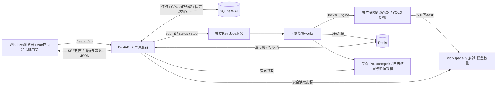
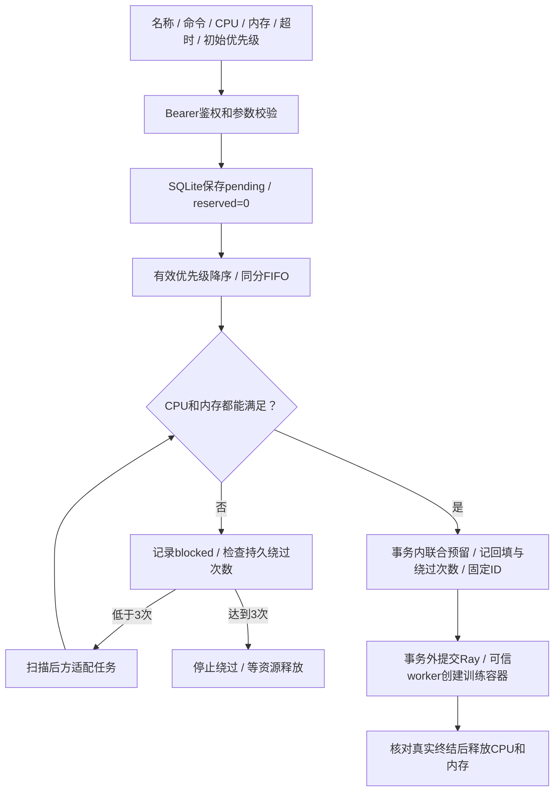
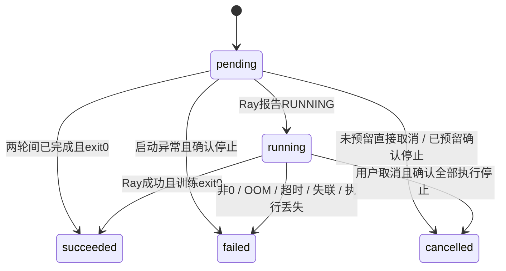
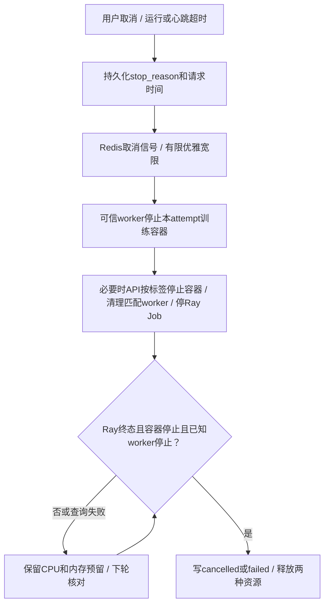
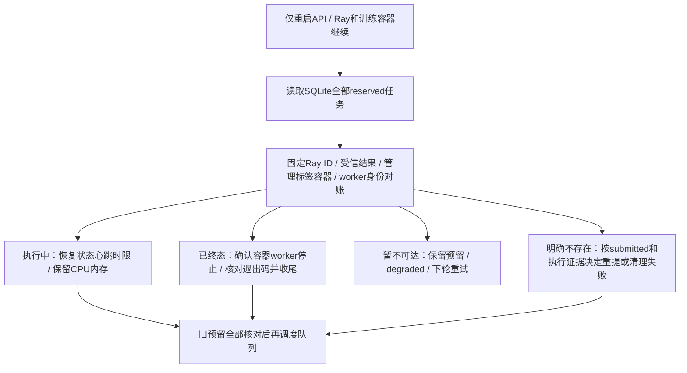
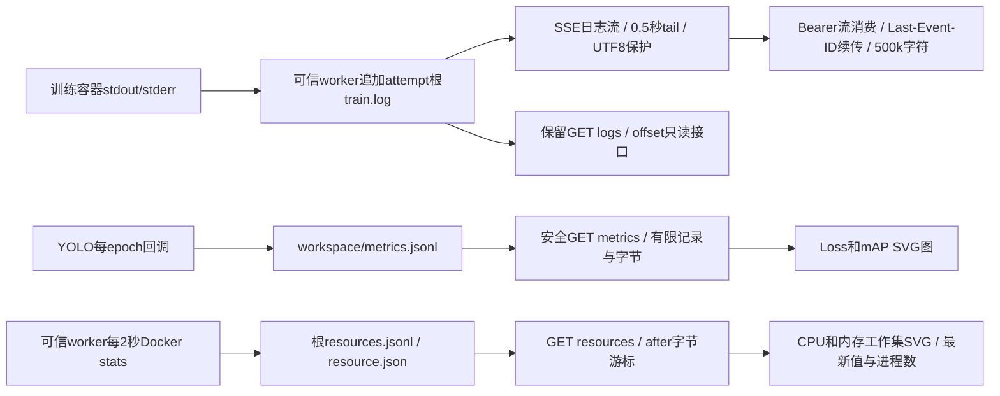

# TrainPlane：整体架构、功能实现与优化空间

答辩阅读版 · 以当前仓库实际代码为准；历史运行证据与新增能力的验证范围在第13节分开说明。仓库地址参见 [项目README](../README.md)。

本文件汇集6张流程图、14节功能解释、代码入口、验收证据与优化建议。另有同内容的 [离线HTML阅读版](architecture-and-implementation.html)：双击阅读、图面缩放和横向滚动、打印均可离线使用，不依赖CDN。

**平台保存训练意图，原子预留CPU和内存，Ray启动可信监督worker；worker创建独立、受限的Docker训练容器并采集真实资源。API确认Ray、容器及已知worker都停止后，才释放资源。**

## 目录

- [1. 已实现范围与运行边界](#s1)
- [2. 总体架构与组件分工](#s2)
- [3. 提交、排队与调度](#s3)
- [4. 状态机与内部控制字段](#s4)
- [5. CPU、内存、心跳和超时控制](#s5)
- [6. 取消与执行清理](#s6)
- [7. 重启恢复与提交不确定性](#s7)
- [8. 日志、指标与资源采样](#s8)
- [9. 持久化结构与文件说明](#s9)
- [10. HTTP接口、鉴权与参数](#s10)
- [11. 四个前端页面](#s11)
- [12. P0、P1与P2对照](#s12)
- [13. 实测证据与演示顺序](#s13)
- [14. 优化空间与适用条件](#s14)

<a id="s1"></a>
## 1. 已实现范围与运行边界

| 维度 | 当前事实 |
|---|---|
| 技术栈 | Python 3.12、FastAPI、Ray Jobs、Redis、SQLite；Vue3、Vite、TypeScript、Element Plus；ultralytics YOLO和CPU版PyTorch |
| 稳定交付路径 | Windows宿主运行浏览器、Node前端和Docker Desktop；Linux容器运行Ray、API、Redis；每次训练另建独立Docker容器 |
| 默认规模 | 单Ray节点、单API调度进程；CPU总配额2，内存总配额2048MB；每任务默认CPU2、内存1024MB |
| 训练负载 | yolov8n、coco128、CPU、1 epoch、imgsz=320、batch=1、workers=0、cache=False；数据及权重提前缓存 |
| 自研部分 | 四页UI、令牌门禁、任务接口、持久队列、状态机、联合资源账本、公平调度、看门狗、日志/指标/采样和恢复 |
| Ray承担部分 | 运行可信worker、入口逻辑CPU预留、作业状态与停止；通过Python Jobs SDK封装，不嵌入Ray Dashboard业务页面 |
| 任务隔离 | 独立训练容器：CPU/内存/PID硬限、nonroot、只读根文件系统、无网络、最小挂载、移除capabilities |
| 访问边界 | 单operator Bearer令牌；端口绑定127.0.0.1；不是多用户身份系统或RBAC。Docker socket仅可信控制平面可访问 |
| 禁用能力 | 不使用GPU、NCCL、DDP，不嵌入第三方训练平台页面；Ray Dashboard仅诊断 |
| 原生Windows排查路径 | 保留process模式用于排查；不具备Docker任务硬隔离，不能与稳定交付路径等同。历史Ray挂起问题见验收记录 |

当前实现已有鉴权、容器限制、资源采样、老化和受限回填，不能再把这些列为“未实现”。它仍是单机、单operator平台，后文清楚区分已实现机制、运行证据和生产化建议。

<a id="s2"></a>
## 2. 总体架构与组件分工



| 组件 | 职责 | 代码入口 |
|---|---|---|
| FastAPI | 鉴权、参数校验、提交/查询/取消/资源/日志/指标；lifespan启动调度器 | [main.py · lifespan/JobCreate/public](../backend/app/main.py)、[auth.py · authorize/get_token](../backend/app/auth.py) |
| 调度器 | 先核对旧预留，再执行老化排序、受限回填和CPU/内存原子预留；管理终态 | [scheduler.py · Scheduler.tick/dispatch/reconcile/finish](../backend/app/scheduler.py) |
| SQLite | 业务事实、状态、时间、两种资源申请、预留、固定执行ID和绕过次数 | [store.py · initialize/connection](../backend/app/store.py) |
| Redis | worker短期心跳与取消信号；不是唯一历史存储 | [worker.py · run_container/main](../backend/app/worker.py) |
| Ray Jobs | 在API外启动可信worker；入口申请job.cpu，不再嵌套申请另一份Ray训练CPU | [scheduler.py · Scheduler.submit](../backend/app/scheduler.py) |
| Docker边界 | 固定受信镜像和挂载白名单，按attempt命名/标签核对容器，启动/检查/停止和stats转换 | [containers.py · create_task/inspect_task/stop_task/resource_sample](../backend/app/containers.py) |
| 监督worker | 可信控制代码持有Redis/Docker连接，传入训练容器的命令只在容器内执行；捕获日志、心跳、退出、超时和采样 | [worker.py · run_container/main](../backend/app/worker.py) |
| YOLO训练 | CPU和coco128、Torch线程回调、每epoch指标与权重 | [train.py · main](../backend/app/train.py) |
| Vue | 四业务页面，真实API，App内令牌登录、资源/队列/日志/指标展示 | [App.vue](../frontend/src/App.vue)、[api.ts](../frontend/src/api.ts) |

[compose.yaml](../compose.yaml) 启动控制平面：仅API8000发布到宿主127.0.0.1；Ray Jobs HTTP8265和Redis6379仅供容器网络内部使用，不发布宿主端口，避免绕过平台Bearer直接提交Ray作业。Ray GCS使用6380。API经http://ray:8265与redis服务名访问执行器和心跳服务。前端5173单独运行，`/api`由Vite代理到宿主8000。

API使用 `pid: service:ray`，与Ray共享监督worker的Linux PID视图和持久数据；这支持API重启后按PID+创建时间核对worker。**训练容器有独立PID命名空间，不能拿容器内数字PID去控制平面杀进程。** Docker模式下 `local_identities()`只返回可信worker身份，训练存活/停止由Docker inspect确认。

API/Ray挂载Docker socket属于高权限控制平面，不能交给用户命令。训练容器只挂该attempt的 `workspace → /task` 可写、数据集与模型只读，不挂attempt根、数据库、API专属认证目录或Docker socket；可选字体也仅只读挂载。该隔离降低任务影响面，不等于抵御Docker/内核漏洞的多租户安全保证。

<a id="s3"></a>
## 3. 提交、排队与调度



1. `POST /api/jobs` 校验后只写SQLite并返回201，训练不在HTTP请求线程同步执行。每任务保存CPU、memory_mb、时限和初始priority。
2. `dispatch()` 使用 `BEGIN IMMEDIATE`，同一写事务统计所有 `reserved=1` 的CPU及内存，再选任务、设置预留、持久化回填计数和固定提交ID。
3. `effective_priority = priority + floor(wait_seconds / AGING_INTERVAL_SECONDS)`，默认老化间隔60秒，**有效优先级不封顶**；初始优先级只允许0～10。同有效分值按 `created_at,id` FIFO。调度计算pending任务的当前等待；API对running/terminal展示值冻结到started_at或finished_at。
4. 队首无法同时满足CPU和内存时，记录到blocked并继续扫描后方任务，适配者可回填。每实际预留一个后方任务，**所有被绕过的blocked任务**的 `bypass_count` 持久化加1；不是每次轮询加1。任一被阻塞任务达到默认3次，就停止继续绕过，等待资源释放。`backfilled` 标记实际回填任务。
5. 无抢占；已运行任务继续占有资源。老化与有限回填改善等待公平性，但不是严格的最大等待时间SLA，也没有为队首计算未来完成时间的完整保守reservation算法。
6. 固定Ray ID为 `{job_id}-1`；当前没有自动重试。先提交SQLite事务，再调用Ray；调用异常保留CPU/内存预留，下轮按同一ID对账，不能立即释放后盲目重提。
7. 每轮先对账全部旧预留，再放行新任务；`finish()`统一保存终态、结束时间和 `reserved=0`，两种资源一起释放。

代码：[main.py · create_job](../backend/app/main.py)、[scheduler.py · effective_priority/dispatch/submit/finish](../backend/app/scheduler.py)。

并发边界：调度/取消共用RLock，数据目录文件锁拒绝第二个调度器；单Uvicorn worker、不启用reload。SQLite与Ray/Docker不是同一分布式事务，固定ID、确定容器名及spec标签降低重复执行风险，但不宣称全局恰好一次。创建接口没有业务幂等键，重复HTTP提交仍会创建不同任务。

<a id="s4"></a>
## 4. 状态机与内部控制字段



| 对外状态 | 判断依据 |
|---|---|
| pending | 已保存，排队或等待执行器开始；可能已经预留CPU/内存，不能凭标签判断资源空闲 |
| running | Ray已报告RUNNING；worker/训练初始化可能未完成，started_at可暂为空 |
| succeeded | Ray终态SUCCEEDED且训练结果或驱动退出码确认为0；提交成功不是训练成功 |
| failed | 非0退出、容器OOM、超时、心跳/首次心跳超时、执行器明确丢失等，error解释原因 |
| cancelled | 用户取消；已预留任务必须确认真实停止后才终结和回收 |

`reserved/submitted/running_seen_at/stop_requested_at` 是内部控制字段，不添加题目之外的对外状态。`stop_reason`返回前端用于“正在停止”和禁用重复取消；`memory_mb/bypass_count/backfilled`已持久化，`effective_priority/queue_wait_seconds/resource_usage`由API计算或读取最新可信采样。

取消前先核对Ray已终态的任务，避免过晚取消覆盖已确认成功。终态重复取消保持原结果。短任务可在两轮间直接从pending收尾为succeeded，不补虚假running。任务状态与资源释放以可信执行证据为准，不信任训练workspace内自行写出的结果文件。

代码：[scheduler.py · request_cancel/reconcile](../backend/app/scheduler.py)、[main.py · public](../backend/app/main.py)。

<a id="s5"></a>
## 5. CPU、内存、心跳和超时控制

### 两种资源与执行限制

| 层次 | 当前实现 | 边界 |
|---|---|---|
| 平台账本 | 默认总CPU2、总内存2048MB；每任务默认内存1024MB。可用量分别减去所有reserved任务申请 | 调度配额不是瞬时利用率；pending也可能预留 |
| Ray逻辑资源 | `entrypoint_num_cpus=job.cpu`、GPU=0，控制可信worker并发 | Ray资源声明不是OS级硬限 |
| 每任务Docker硬限 | nano_cpus=cpu×10^9；memory及memory+swap设相同字节上限；pids_limit=128 | CPU限制CPU时间而非独占物理核；内存超限可触发容器OOM；监督worker开销属于控制平面 |
| 训练线程 | OMP/MKL/OpenBLAS等变量，Torch intra-op=配额、interop=1；训练/验证回调恢复线程数 | Ultralytics设备选择会重设线程，单次环境变量设置不足 |
| 文件/权限/网络 | user1000:1000、只读根、network none、cap_drop ALL、no-new-privileges；/tmp为128MiB tmpfs，nosuid/noexec | 训练只可写本任务/task和受限临时目录；没有GPU设备、Docker socket或控制平面凭据 |

默认一个2核YOLO占满CPU配额，两个1核短任务可并发；内存同时参与判断，CPU够但内存不足仍排队。Docker训练容器 `init=True`、不自动重启、不自动删除，保留退出/OOM及限制配置供核对。输入命令按argv解析，在受限容器执行，不是把命令放进可信Ray worker的shell运行。

代码：[containers.py · create_task](../backend/app/containers.py)、[compose.yaml](../compose.yaml)、[train.py](../backend/app/train.py)。

### 心跳与依赖故障

| 信号 | 默认行为 |
|---|---|
| worker心跳 | 每2秒；Redis键heartbeat:{submission_id}，值Unix时间，TTL30秒；本地heartbeat.json辅助排查 |
| 常规失联判定 | 收过心跳后超过15秒未更新；不是等TTL30秒 |
| 首次心跳 | Ray RUNNING后最多等待90秒初始化宽限 |
| Redis恢复 | 恢复后的前4秒暂缓心跳超时，给worker续报机会 |
| Redis故障 | 暂停新调度，保留CPU/内存；不批量误判worker死亡，worker尝试重连 |

心跳证明监督worker能上报，不证明模型有训练进展。资源采样是另一条观测链路，不能把“日志暂时没输出”或“CPU暂时低”直接当作失联。

### 运行超时与故障边界

worker从训练实际开始后用monotonic计时，监督循环负责取消/超时；调度器以持久started_at和墙上时间兜底。排队时间不计入运行时长，Ray RUNNING到训练开始之间受首次心跳宽限约束；运行超时归failed。

Ray HTTP `BoundedJobClient` 设置连接2秒、读取5秒。Ray不可达时tick直接返回，协调侧该轮不再推进后续看门狗，worker自身超时仍独立运行；Docker inspect失败不是停止证据，保留两种资源。墙上时钟跳变、单循环串行和控制平面存储异常仍有优化空间。

代码：[worker.py · run_container/main](../backend/app/worker.py)、[scheduler.py · BoundedJobClient/tick/reconcile](../backend/app/scheduler.py)、[config.py](../backend/app/config.py)。

<a id="s6"></a>
## 6. 取消与执行清理



- 未预留排队任务可直接cancelled，没有已启动执行器或预留待清理。
- 已预留任务先保存停止意图，Redis取消键 `cancel:{submission_id}` TTL3600秒。只有Redis可用且已知执行仍存活时，协调侧最多给4秒优雅收尾；不要求所有异常固定等待。
- Docker模式按确定容器名和管理/attempt标签控制，拒绝同名但非平台拥有的容器。停止后重新inspect；只有明确stopped或Engine确认404才能证明容器不再运行，连接/权限错误继续保留预留。
- API/Ray共享PID只用于监督worker核对，按PID+创建时间避免复用误杀。训练PID属于独立命名空间，不能用其数值在API侧kill。
- Ray终态本身不足以回收：仍需确认训练容器与已知worker都停止。控制平面停止异常保留资源，下轮再核对，前端继续显示“正在停止”。
- process排查模式保留stop_tree先terminate、等待、再kill的已知进程树清理；其隔离能力不能等同Docker稳定路径。

可信worker负责写attempt根result/process/heartbeat/resource；训练容器只能写workspace，不能通过伪造 `/task/result.json` 或进程文件直接控制平台结果或杀进程目标。

代码：[scheduler.py · stop_local/local_alive/container_running/request_cancel/reconcile](../backend/app/scheduler.py)、[containers.py · stop_task/inspect_task/_owned](../backend/app/containers.py)、[worker.py · run_container/main](../backend/app/worker.py)。

<a id="s7"></a>
## 7. 重启恢复与提交不确定性



先落资源预留和固定提交ID，再调用Ray。Ray已接受但响应丢失时，下轮按同ID接管；容器名由attempt确定，labels/spec摘要核对执行配置，重复create不能悄悄替换任务规格。

连接超时不等于任务不存在。仅Ray明确不存在，且submitted=0、没有停止意图、没有process/result等执行证据、没有存活容器/worker时，才可按原ID提交。已有执行证据则不当新任务重跑，清理确认后失败或取消，说明执行丢失。

API重启不将账本清零，也不把仍在运行的容器当空闲；共享控制平面PID视图、持久attempt根和Docker管理标签支持重新核对。调度器文件锁拒绝同数据目录第二个协调进程。

恢复的是管理能力和资源账本，**不承诺Ray/整机重启后自动断点续训**。自动重试、自动resume尚未实现。单任务对账异常可中止该轮后续任务，下轮重试；严格多副本fencing、分布式事务和业务幂等键仍是扩展方向。

代码：[scheduler.py · tick/reconcile](../backend/app/scheduler.py)、[containers.py · create_task](../backend/app/containers.py)、[recovery.py](../scripts/recovery.py)。

<a id="s8"></a>
## 8. 日志、指标与资源采样



### 日志：SSE流与保留的offset GET

每attempt独立train.log，可信worker捕获训练容器stdout/stderr追加，训练容器不挂载该控制文件。API seek(offset)有界读取，不一次从Ray获取全量历史。

| 字段 | 语义 |
|---|---|
| offset / limit | 从0开始的字节位置；默认65536字节，最小4、最大1048576 |
| content / next_offset | UTF-8文本及实际消耗后的字节位置；前端直接使用next_offset，不按文本长度推算 |
| eof / finished | 当前文件已读到末尾 / 任务已终态；两者都真才停止前端日志请求 |

UTF-8跨边界或运行中半字符暂不消费，下一次接续；终态非法残字节用替换字符。offset超界416；文件未生成时仅offset=0返回空，正offset返回416，不能静默回退到0。当前不轮转或截断历史文件。

详情页默认使用 **SSE实时日志**：`GET /api/jobs/{id}/logs/stream?offset=0`。fetch携带Authorization Bearer，再通过ReadableStream/TextDecoder流式消费；令牌不进query。原GET logs保留供只读工具与历史兼容，前端没有自动回退到日志轮询。服务端仍读取同一份持久日志，不需要复制到Redis或一次加载所有历史。

| SSE规则 | 当前实现 |
|---|---|
| 恢复位置 | query offset默认0；Header `Last-Event-ID` 存在时优先。该应用限定最多32个非负ASCII数字，代表已消费的文件字节位置，不是时间或字符数 |
| 预响应校验 | Bearer无效401、任务不存在404、位置超界416、非法Header/参数422；先校验，再发HTTP200流 |
| 响应格式 | `text/event-stream`，开头 `retry: 1000`；`Cache-Control: no-cache, no-transform`、`X-Accel-Buffering: no` |
| log事件 | 仅有非空content时发送，id=next_offset，data为原增量JSON（content/next_offset/eof/finished） |
| end事件 | 业务终态且日志已读到EOF后发送；尾部先log全部排空，再end，end的content为空，沿用最终id，不重复最后内容 |
| error事件 | 200之后发生文件截断/丢失/读取异常时发送 `{code,message}` 后关闭，不改变已发HTTP状态；没有新字节游标 |
| 空闲与tail | 每0.5秒检查状态/文件；有大段历史时连续排空；空闲约10秒发 `: heartbeat` 注释，注释不作为业务事件 |

```text
retry: 1000

event: log
id: 6
data: {"content":"hello\n","next_offset":6,"eof":true,"finished":false}

: heartbeat

event: end
id: 6
data: {"content":"","next_offset":6,"eof":true,"finished":true}

```

示例中的空白行是事件分隔符。客户端支持UTF-8网络分块、CR/LF/CRLF、注释、多行data；只有收到完整帧并完成onChunk消费后才推进游标，连接中断留下的半帧被丢弃，下次从已消费字节重读。它校验id与next_offset一致、游标不回退、安全整数与事件大小，不用网络chunk长度推断文件offset。这是沿用 [WHATWG SSE格式](https://html.spec.whatwg.org/multipage/server-sent-events.html) 的自定义fetch消费者，重连由应用实现，不声称浏览器EventSource自动管理了Bearer连接。

网络异常按1/2/4/8/10秒退避，收到有效内容或连接稳定后重置；30秒没有任何字节（包括注释心跳）会中止失活连接并重连。401经统一鉴权处理清会话；其他4xx和协议错误停止自动重连，显示原因。416/日志截断不自动清零；用户可明确点“从头重新读取”，或点“重连”从当前已消费位置重试。切任务、登出、卸载会Abort旧连接；generation和连接身份检查拒绝旧流回调串入新任务。

raw logs仍最多保留最近500000个JS字符单元，再由displayLogs整体剥离ANSI CSI、归一化CRLF/CR。暂停仅暂停自动滚动，仍持续消费SSE；复制清理后的当前可见内容，裁剪有提示。Vue文本插值不执行日志HTML。详情/资源继续每1.5秒轮询，指标每4轮约6秒，通用api.ts的15秒超时只作用普通请求；长流使用自己的30秒无字节看门狗。当前没有关键词高亮或虚拟滚动。

API容器Uvicorn设置 `--timeout-graceful-shutdown 5`，避免活跃SSE无限阻止仅API重启；Ray、worker和训练容器保持独立。断线续传范围是同一持久日志的字节序列，不是自动跨轮转/截断的全局消息队列保证。

### YOLO指标

on_fit_epoch_end按epoch去重、过滤非有限值，将 `{epoch,timestamp,metrics}` 追加到workspace/metrics.jsonl，权重也保存在workspace。GET指标优先读取workspace，兼容旧attempt根布局；使用O_NOFOLLOW、O_NONBLOCK和fstat普通文件检查，拒绝指标文件符号链接/FIFO，限制读取字节与记录数，防止用户可写文件阻塞API。

接口映射box/cls/dfl loss、mAP50、mAP50-95，最多返回**从头最早1000条有效记录**且有约1MiB读取预算；单行读取上限16384字节。没有epoch游标、指标POST或长期指标存储服务。前端每4轮约6秒获取，原生SVG切换Loss/mAP，1 epoch只有一个点。

### 容器资源采样

可信worker默认约每2秒从Docker Engine获取本任务容器全进程聚合stats，追加根resources.jsonl并原子更新resource.json。采样不由训练脚本自行上报，训练workspace不挂载这些文件；RPC耗时可拉长实际采样间隔，极短任务可能没有采样。run_container独立日志线程捕获容器输出，监督循环不因安静日志阻塞；OOM识别写memory_limit原因、退出码137和oom_killed，container.json保留最终inspect。

| 采样字段 | 语义 |
|---|---|
| timestamp | Unix秒，前端乘1000转浏览器时间 |
| cpu_percent | 根据CPU/system delta和online CPU数计算；**单核满载100%，两核约200%**，不是按任务配额归一到100% |
| memory_mb | 容器工作集：max(usage−inactive_file,0)/1024²；不是纯RSS |
| memory_usage_mb | 含缓存的Docker原始usage/1024²，保留供诊断 |
| memory_limit_mb / pids | 容器硬内存上限 / 容器内进程与线程数 |
| container_id / execution_mode / status | 执行容器身份、模式与采样时容器状态 |

`GET /api/jobs/{id}/resources?after=0&limit=300` 的after/next_offset是**独立文件的字节游标**；limit默认300、范围1～1000，并有1MiB批次预算和单行上限。只消费完整JSONL行，运行中半行留待下轮；返回items、next_offset、eof、finished、latest，越界416。前端详情每1.5秒增量读、保留最近600条曲线，最新值比较时间戳取新；只有finished且eof才停资源请求，终态仍会读完剩余历史。

代码：[main.py · logs/log_event/log_stream/metrics/resources](../backend/app/main.py)、[sse.ts · SSEParser/followJobLogs](../frontend/src/sse.ts)、[containers.py · resource_sample](../backend/app/containers.py)、[worker.py · run_container/main](../backend/app/worker.py)、[JobDetail.vue · connectLogs/poll](../frontend/src/views/JobDetail.vue)、[ResourceChart.vue](../frontend/src/components/ResourceChart.vue)、[MetricChart.vue](../frontend/src/components/MetricChart.vue)。

<a id="s9"></a>
## 9. 持久化结构与文件说明

| SQLite字段 | 用途 |
|---|---|
| id/name/command | 业务ID、名称、要在受限训练容器内执行的命令 |
| cpu/memory_mb/timeout_seconds/priority | CPU、内存申请、实际运行时限、初始优先级 |
| status/created_at/started_at/finished_at/heartbeat_at | 五状态和生命周期；库内Unix秒，API时间字段转UTC ISO |
| exit_code/error/ray_submission_id | 可信结果、原因、唯一固定执行ID |
| reserved/submitted | 两种资源仍预留 / 已明确提交或核对到Ray执行 |
| stop_reason/stop_requested_at/running_seen_at | 停止意图、有限宽限和首次心跳控制 |
| bypass_count/backfilled | 被实际回填任务绕过的持久次数 / 本任务是否回填 |

initialize保留兼容迁移，新增memory_mb默认1024、bypass_count/backfilled默认0。SQLite WAL、busy_timeout10000ms，独立连接提交/回滚；资源预留用BEGIN IMMEDIATE；查询使用SQL参数，ID搜索转义LIKE通配符。有效优先级和等待时间由持久提交/开始/完成时间推导，不需每秒写库。

```text
backend/.auth/api-token                    # 仅API挂/app/auth/api-token；Ray/训练不挂
backend/data/                              # 控制平面/app/data，训练不整体挂载
  platform.sqlite3 / scheduler.lock        # 任务事实与单协调器锁
  datasets/coco128/                        # 仅以只读数据集挂入训练
  ultralytics/                            # 字体等预缓存
  jobs/{job_id}/{submission_id}/           # 可信监督worker控制的attempt根
    config.json / process.json             # 配置、worker身份、容器身份等
    heartbeat.json / result.json           # 辅助心跳、可信退出、oom_killed和错误
    container.json                         # 停止后的Engine inspect证据
    train.log                             # 捕获的独立输出
    resources.jsonl / resource.json        # 聚合资源历史 / 最新快照
    workspace/                            # 唯一任务可写宿主目录，映射/task
      metrics.jsonl / coco128.yaml         # 训练指标与数据路径配置
      artifacts/train/weights/             # best.pt / last.pt
```

process/result/heartbeat/resource等快照使用临时文件、flush/fsync/replace原子更新；日志、指标和资源历史用追加。Redis AOF与持久卷辅助恢复，但业务历史及CPU/内存预留以SQLite为准。运行数据、令牌、模型和缓存不提交Git。

| 源文件 | 入口 |
|---|---|
| [main.py](../backend/app/main.py)、[auth.py](../backend/app/auth.py) | lifespan、JobCreate、public、路由、authorize/get_token |
| [config.py](../backend/app/config.py)、[store.py](../backend/app/store.py) | 默认CPU/内存/老化/回填/执行模式、表与迁移 |
| [scheduler.py](../backend/app/scheduler.py) | tick/dispatch/submit/reconcile/request_cancel/finish、容器和worker存活核对 |
| [containers.py](../backend/app/containers.py)、[worker.py · run_container/main](../backend/app/worker.py) | 训练容器安全规格、Docker状态/清理/聚合采样和监督 |
| [train.py](../backend/app/train.py)、[demo.py](../backend/app/demo.py) | 真实CPU训练及确定性故障演示 |
| [compose.yaml](../compose.yaml)、[Dockerfile](../backend/Dockerfile) | 控制平面服务、Docker socket、共享控制PID和基础镜像 |
| [frontend/src](../frontend/src)、[frontend/tests](../frontend/tests) | 四页、App门禁、API封装、SVG图与鉴权可运行检查 |
| [scripts](../scripts)、[backend/tests](../backend/tests) | 安装/预缓存/启停/验收与边界测试 |

<a id="s10"></a>
## 10. HTTP接口、鉴权与参数

**除GET /api/health外，全部/api接口必须携带Authorization: Bearer令牌。** auth.authorize使用常量时间比较；未提供或无效返回401和WWW-Authenticate。GET /api/auth/session也是受保护接口，验证成功返回authenticated=true、username=operator。

令牌优先来自TRAINPLANE_API_TOKEN；未配置则在API专属backend/.auth/api-token（容器内/app/auth/api-token）以排他创建、权限0600写入随机值，后续复用。该目录被Git忽略，仅挂给API，不挂Ray或训练；启动只提示文件路径，操作者手动读取后在页面输入。前端令牌只存sessionStorage并在Header传递，不放URL、日志或训练环境；401清除并回App内门禁。单operator不代表注册登录、多用户配额或RBAC；Ray/Redis不发布宿主端口；仍不承诺对拥有Docker管理权限者保密，可信API/Ray的socket权限必须保护。

| 方法与路径 | 实现 |
|---|---|
| GET /api/health | 匿名依赖/调度健康，异常degraded |
| GET /api/auth/session | 受保护的会话验证，返回operator |
| GET /api/cluster | CPU与内存总/已分配/可用、运行/排队、老化间隔、最大绕过次数、节点瞬时利用率 |
| POST /api/jobs | 校验并持久化，201；资源暂不足排队而非拒绝 |
| GET /api/jobs | page默认1、page_size默认10范围1～100；状态精确筛选、ID子串搜索；提交时间倒序 |
| GET /api/jobs/{id} | 配置、状态、时间、停止原因、退出码、有效优先级、冻结等待、回填标记和最新聚合采样 |
| POST /api/jobs/{id}/cancel | 保存取消意图，返回当前状态，终态重复取消保持 |
| GET /api/jobs/{id}/logs | offset/limit字节有界读取，next_offset/eof/finished |
| GET /api/jobs/{id}/logs/stream | Bearer SSE；Last-Event-ID优先query offset，log/end/error事件及10秒注释心跳 |
| GET /api/jobs/{id}/metrics | 安全读取workspace，兼容历史根；最多最早1000条且有字节预算 |
| GET /api/jobs/{id}/resources | after/limit增量读取资源JSONL，next_offset/eof/finished/latest |

```json
{"name":"YOLO CPU 演示","command":"python -m app.train --epochs 1 --imgsz 320 --batch 1","cpu":2,"memory_mb":1024,"timeout_seconds":1800,"priority":0}
```

name1～100、command1～4096且去空白非空；CPU正整数不超过总量；memory_mb整数至少64且不超过总内存；时限1～86400秒；初始priority0～10。接口未知任务404、参数错误422、游标超界416、非法指标路径400、鉴权失败401。SSE在200之前返回这些校验错误，流开始后用error事件说明读异常。没有任务删除、失败自动重试、文件下载、指标POST、注册或Webhook路由。

节点psutil数据是Docker Linux节点整体观察，不是可用账本，也不等于每任务stats。资源分配由reserved汇总，任务采样由可信worker的Docker stats取得，两者用途不同。

<a id="s11"></a>
## 11. 四个前端页面

App.vue内置令牌门禁，不增加第五业务路由。登录先验证/auth/session，成功才挂载RouterView；sessionStorage恢复同样需验证。api.ts统一Bearer、15秒超时、错误解析和401清会话；旧会话的迟到401不会清除刚验证的新令牌。退出登录清除会话并卸载业务页面。

| 页面 | 展示 | 数据与交互 |
|---|---|---|
| /overview | CPU卡片/环图、内存总/已分配/可用、节点实际负载、依赖状态、公平调度间隔和绕过阈值、最近任务 | 每3秒cluster与最近5任务并发查询，busy防重入 |
| /jobs | 五状态、资源配额、初始/有效优先级、等待时长、回填标签、ID搜索和状态筛选、分页、详情/日志/取消 | 每3秒刷新，筛选回第1页，10/20/50每页，序号拒绝旧响应，终态/停止中禁重复取消 |
| /submit | 默认CPU命令，名称/命令/CPU/内存/时限/初始优先级；CPU+内存快照及排队提示 | Element Plus校验，内存整数64～总量默认1024；submit trim后POST、loading、成功跳列表；资源快照只提示 |
| /jobs/:id | 基础/执行/公平性信息、SSE终端、真实聚合CPU/内存工作集/进程数/时间、双SVG资源曲线、Loss/mAP | 日志为可恢复SSE，详情/资源1.5秒、指标约6秒；日志/资源各用独立字节游标，日志end与资源终态EOF分别结束 |

JobDetail.vue的connectLogs/AbortController/generation防旧流串任务，poll/busyGeneration防普通请求重入；displayLogs/toggleFollow/copyLogs控制可读日志，raw上限500k字符不改变byte offset；终端显示连接中/已连接/重连中/读取完成/已停止，并提供手动重连与显式从头读取。资源曲线保留最近600条并使用Unix秒时间轴，单核100%不截断到100%。ResourceChart.vue区分配置硬限与实测值，空任务不生成假数据。

Submit.vue规则：名称必填非空白≤100，命令必填非空白≤4096，CPU≥1，内存整数≥64且≤集群总量，超时1～86400；数字控件限制整数范围，初始优先级0～10。表单novalidate使用Element校验，避免原生step与默认值冲突。可用资源同时比较CPU和内存，最终调度仍重新判断。

代码：[App.vue](../frontend/src/App.vue)、[api.ts](../frontend/src/api.ts)、[sse.ts](../frontend/src/sse.ts)、[四页views](../frontend/src/views)、[ResourceChart.vue](../frontend/src/components/ResourceChart.vue)、[MetricChart.vue](../frontend/src/components/MetricChart.vue)、[StatusBadge.vue](../frontend/src/components/StatusBadge.vue)。

整站没有深色开关、浏览器任务通知、日志关键词高亮或虚拟滚动；终端深色视觉/ANSI清理不冒充这些特性。路由静态导入和Element整包注册保留首包优化空间。

<a id="s12"></a>
## 12. P0、P1与P2对照

| 层级 | 当前实现/设计 | 边界 |
|---|---|---|
| P0后端 | 全部任务/资源/日志接口、CPU排队回收、五状态、心跳、超时、日志与元数据持久化、API重启对账；可选SSE已实现 | 单机单协调器；SSE与原offset GET并存，Bearer Header续传 |
| P0前端 | 四页、筛选分页、提交跳转、标签、详情、日志暂停滚动和复制 | 真实API，完整历史在服务器 |
| P1优先级 | 初始priority、等待老化、同分FIFO、有限回填和持久绕过计数 | 无抢占、无最大等待SLA |
| P1训练指标 | 每epoch持久化、GET安全读取、Loss/mAP SVG | 无外部POST存储/游标/长期指标服务 |
| P1资源采样 | 可信worker每2秒Docker聚合CPU/内存工作集/进程数，JSONL、最新快照、增量API与SVG | 内存工作集不是RSS；历史曲线前端保留最近600条 |
| 已加固能力 | 单operator令牌、CPU/内存联合预留、每任务CPU/内存/PID硬限、非root/无网络/最小挂载 | 不是多用户RBAC或抗内核漏洞沙箱 |
| 其他P1 | 自动重试、单用户CPU总配额、日志高亮、通知、整站深色和虚拟滚动未做 | 单operator共享平台总量不等于多用户配额系统 |
| P2多节点 | 设计Ray多节点与可信执行代理、日志/产物共享存储 | 未编码 |
| P2流水线 | 设计预处理→训练→评估依赖，各步单独资源和attempt | 未编码 |
| P2数据集/产物 | 有固定coco128预缓存和本地权重，设计版本化对象存储与授权下载 | 无完整管理页面/下载API |
| P2Webhook | 设计事务outbox、签名、幂等、退避与死信 | 未编码 |

P2口述提纲见 [design-p2.md](design-p2.md)。本表区分“当前实现”与“已运行验证”；新增能力不能沿用旧证据冒充本轮通过，实际验证范围见第13节。

<a id="s13"></a>

## 13. 实测证据与演示顺序

### SSE实时日志升级实测（2026-11-02）

| 证据 | 本轮实际结果 |
|---|---|
| [sse-unit-results.json](sse-unit-results.json) | 后端Linux全量48 passed、无skip、52.68秒，含真实Docker集成；前端13 passed，生产构建成功19.01秒 |
| [sse-results.json](sse-results.json) | 经Vite代理四组通过：鉴权/预响应错误码，空闲10秒心跳、pending→running同流及尾排空，Last-Event-ID续传无重复/丢失及API重启，416/422验证；活跃流重启API用时5.64秒，Ray不动，结束双配额归零 |
| [sse-browser-results.json](sse-browser-results.json) | 任务cfde268bf3984f4f实际建立两条流，URL只有offset0/1035且无凭据；API重启自动续传，暂停/复制成功，取消后收到end；DOM5004字符与持久日志去ANSI/CR后完全一致、demo只启动一次 |
| [实时截图](screenshots/sse-live.png) / [完成截图](screenshots/sse-finished.png) | 连接状态、续传、可读日志与完成状态的本机浏览器证据 |
| [首轮报告](sse-results-first-run.json) | 首轮worker Docker SDK发生5秒ReadTimeout导致任务失败，未计全通过；后续对失败任务的历史SSE与持久日志诊断一致（170字符）。未修改worker/调度器掩盖瞬时执行器超时，第二轮才四组完整通过 |

本轮只更新API容器与前端，保留Ray、Redis和既有训练执行链路。只把实际完成的重启和断线场景列为通过，不把同一文件游标续传扩张为跨轮转、永久保留或全局恰好一次语义。

### 本次隔离与公平调度升级实测（2026-11-01）

| 证据 | 本轮实际结果 |
|---|---|
| [isolation-unit-results.json](isolation-unit-results.json) | Linux完整测试40 passed、0 skipped、59.80秒；开启真实Docker集成，涵盖鉴权、迁移、指标文件安全、采样游标、老化/回填、双资源预留、取消竞态、硬隔离、OOM及原process兼容；前端npm test与build均通过 |
| [isolation-fairness-results.json](isolation-fairness-results.json) | 真实HTTP五组通过：Bearer、隔离/采样、64 MiB内核OOM137/回收、实际1核回填、默认60秒间隔下旧P0任务老化后先于新P1执行 |
| [isolation-smoke-results.json](isolation-smoke-results.json) | 新独立容器执行路径重新通过P0九项HTTP检查，含取消、运行超时、心跳超时、退出码、日志、筛选及回收 |
| [isolation-recovery-results.json](isolation-recovery-results.json) | 仅重启API，Ray/worker/训练容器身份保持，日志启动一次；排队接续成功，CPU与内存最终都释放 |
| [isolation-yolo-results.json](isolation-yolo-results.json) | 网页提交5c168822dd054af1：CPU2、内存1024 MiB、1 epoch/320/batch1，147.179秒成功退出0；66条采样，原始内存峰值718.551 MiB、工作集峰值487.543 MiB；best/last各6491626字节；四次训练/验证线程检查均2；真实loss/mAP已写入 |
| [isolation-browser-results.json](isolation-browser-results.json) | 网页令牌登录、内存表单、真实YOLO提交跳转、CPU/内存/进程数与SVG曲线、训练指标及退出返回门禁均实测；[资源截图](screenshots/isolation-resources.png)、[YOLO详情](screenshots/isolation-yolo.png) |
| [isolation-final-health.json](isolation-final-health.json) | 平台health=ok、CPU/内存预留均0；为训练临停的其他15个应用容器全部恢复运行，原有5项健康检查全部healthy |

该次训练在同一台8GB机器上临停其他应用后测得，用时不能与历史107秒做严格性能对照。CPU百分比是Docker区间采样估计，硬限由cgroup配置保证，短采样值可能短暂越过图上配额线。单轮coco128精度只用于验证训练与指标链路。

### 历史P0交付基线

下表保留此前版本的历史基线；本次新增能力以本节上方独立报告为准，不混用历史记录。前端新鉴权测试还覆盖Header携带、会话恢复、401清除及旧会话迟到401不会清除新会话。

| 证据 | 实际结果 |
|---|---|
| [yolo-results.json](yolo-results.json) | Docker真实YOLO任务993c67aa8de849fa；1 epoch、320、batch1、CPU2；107.378161秒，succeeded、exit0；四次训练/验证线程检查均2，日志无下载 |
| 同一真实训练指标 | box_loss1.69865、cls_loss3.8395、dfl_loss1.49486、mAP50 0.38557、mAP50-95 0.26747；best.pt/last.pt各6491754字节；结束后allocated0/available2 |
| [verification.md](verification.md) | Linux单元与真实worker测试14 passed、无skip、12.98秒；测试涉及状态/资源、Redis故障、UTF-8、取消竞态、提交不确定性及真实后代清理；这里引用已有执行记录，不声称本文件重新运行了测试 |
| [smoke-results.json](smoke-results.json) | HTTP九项通过：依赖/资源、队列取消、实际运行取消及自动接续、UTF-8增量、exit7、运行超时、心跳超时、筛选分页、资源回收 |
| [concurrency-results.json](concurrency-results.json) | 两个1核任务均实际启动且有心跳，第三个排队；分配不超过2，全部成功并回收 |
| [recovery-results.json](recovery-results.json) | 仅重启API容器；Ray容器ID/StartedAt不变，worker2218、训练2220及创建时间相同；日志启动一次；队列接续成功，51.515秒，最终资源全空闲 |
| [browser-results.json](browser-results.json) | 网页真实提交YOLO成功、筛选、分页、ID搜索、中文日志、暂停/复制、ANSI清理、运行任务取消及资源回收 |
| [页面截图](screenshots/overview.png) | 同目录包含overview、jobs、submit、detail、detail-map五张实测图片 |

本机为i5-8265U、4物理核8线程、约8GB内存。测量时经用户授权临停其他15个Docker应用以释放资源；107.378秒不是所有原有应用共存时的性能，也不是跨机器承诺。coco128训练/验证共用小样本，本次指标用于验证链路，不能当作模型泛化精度基准。

### 可复现操作入口

```powershell
.\scripts\setup.ps1
backend\.venv\Scripts\python.exe scripts\prepare_training.py --mirror
.\scripts\start-docker.ps1 -Build
# 平台空闲时依次验收：
backend\.venv\Scripts\python.exe scripts\smoke.py
backend\.venv\Scripts\python.exe scripts\concurrency.py
backend\.venv\Scripts\python.exe scripts\recovery.py --docker
# 新增资源隔离、公平调度；--aging会实际等待默认60秒老化间隔：
backend\.venv\Scripts\python.exe scripts\isolation_fairness.py --aging
# SSE经Vite代理、带活跃连接的API重启复验：
backend\.venv\Scripts\python.exe scripts\sse_smoke.py --restart-api --restart-delay 20
```

setup默认仅为宿主安装requests/psutil及前端依赖；训练栈在Docker镜像内。预缓存脚本的模型镜像传输验证官方SHA256，coco128来源为Ultralytics的Kaggle数据集，来源和摘要见 [training-assets.json](training-assets.json)。Arial仅从本机字体复制到被忽略的运行目录。原生排查需要 `setup.ps1 -Native`，但不推荐作为稳定演示路径。

建议答辩顺序：先总览讲清两核配额；网页提交默认YOLO；看日志/指标与资源释放；再用短任务演示排队、取消、超时、失联；最后只重启API说明恢复。短任务验证控制逻辑，不替代真实训练。


<a id="s14"></a>
## 14. 优化空间与适用条件

以下是后续生产化方向，不能把已经实现的鉴权、Docker限制、资源采样、老化和回填再次列为缺失。A指多人/公网前优先，B指规模和数据增长时，C指体验优化。

| 方向 | 当前边界 | 下一步与触发条件 | 级别 |
|---|---|---|---|
| 1可靠性 | 单循环串行对账，Ray不可达本轮返回；SQLite/Ray/Docker不是同一事务；无创建幂等键；跨进程使用墙上时间 | 持久提交阶段与幂等键、故障分类/退避、分离本地看门狗与执行器检查、时钟跳变/存储故障注入；扩展时增加fenced租约 | A/B |
| 2身份与权限 | 已有单operator令牌和App门禁，但无用户身份、RBAC、分用户配额和审计；控制平面Docker socket权限高 | 公网前接身份系统/RBAC、令牌轮换与审计、TLS、受限执行代理；管理端点单独保护，训练永不获取控制凭据 | A |
| 3隔离深化 | 已有每任务CPU/内存/PID限制、非root、只读根、无网络和最小挂载；容器共享宿主内核，workspace无磁盘额度 | 按威胁模型选rootless/更强运行时，给workspace磁盘/文件数配额和日志上限；确需联网时设计出口白名单，继续禁止控制端访问 | A/B |
| 4更严格公平性 | 已实现不封顶老化和最多3次绕过，但未预测队首最早启动时间，无抢占或分用户公平份额 | 需要等待SLA时做保守reservation/预计时长模型；多用户再做公平队列和配额，确有价值才做检查点抢占，避免回填侵蚀承诺 | B |
| 5扩展与清理 | 单协调器、RLock内外部IO、SQLite和队列fetchall；已停止训练容器保留证据，尚无保留策略 | 分批队列/缩短IO临界区，独立协调器、事务数据库、选主fencing、节点代理；按标签和保留期回收已终态容器，绝不全局prune | B |
| 6指标与采样历史 | 指标最早1000条/约1MiB，无指标POST/游标；采样JSONL持续增长，前端仅600条 | epoch/记录游标、下采样与归档；远端上报需认证和幂等；保留工作集/原始usage语义，不能改名RSS | B |
| 7日志与产物 | 已有Bearer SSE/断线续传；服务器日志无限追加、物理byte offset，模型无保留/下载授权；前端500k窗口非虚拟滚动 | 磁盘配额、归档压缩、授权下载；轮转引入分片ID+逻辑游标而非直接截断；连接规模增长时增加并发流额度和背压，必要时虚拟滚动 | B/C |
| 8依赖复现 | 核心Python版本固定，有Linux快照；控制依赖通过requirements-control.txt单独锁定Docker SDK7.1并复用Torch缓存层；基础镜像/Redis标签仍浮动 | 完整锁文件、镜像digest、受信制品缓存和摘要、固定升级/回滚与兼容检查 | B |
| 9前端效率 | SSE已有30秒看门狗和有上限重连退避；详情/指标/资源仍固定轮询，终态后详情/指标仍请求；ANSI每次重算窗口 | 路由懒加载/按需组件、后台页降频、普通轮询失败退避、终态最后同步后停不必要请求；分块处理跨chunk ANSI和虚拟滚动 | C |

参考：[Ray逻辑资源](https://docs.ray.io/en/latest/ray-core/scheduling/resources.html)、[SQLite WAL](https://sqlite.org/wal.html)、[FastAPI workers](https://fastapi.tiangolo.com/deployment/server-workers/)。本项目不能直接调大Uvicorn workers，是应用代码事实：每个lifespan启动调度器，同数据目录文件锁会拒绝第二实例；应先拆独立调度器再扩API。

答辩取舍：用单机可复现的真实CPU训练验证全链路，再把新增的安全边界、实际资源观测和公平性讲清楚；控制平面与任务容器各自负责什么、哪里尚无强保证，都应有代码和证据支撑。
