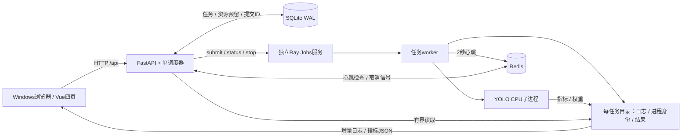
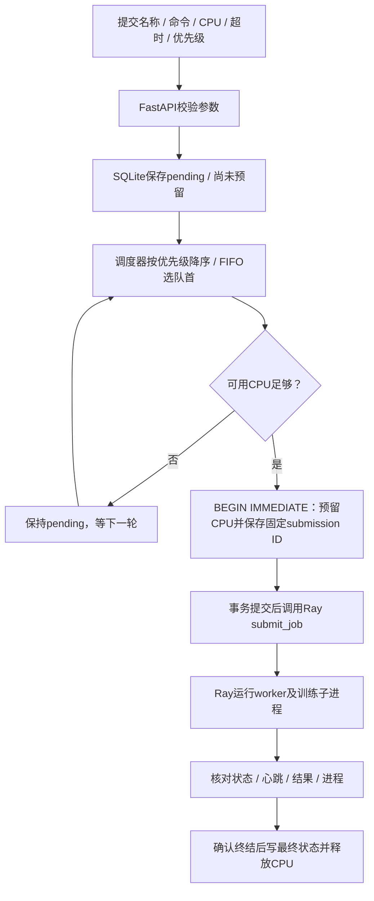
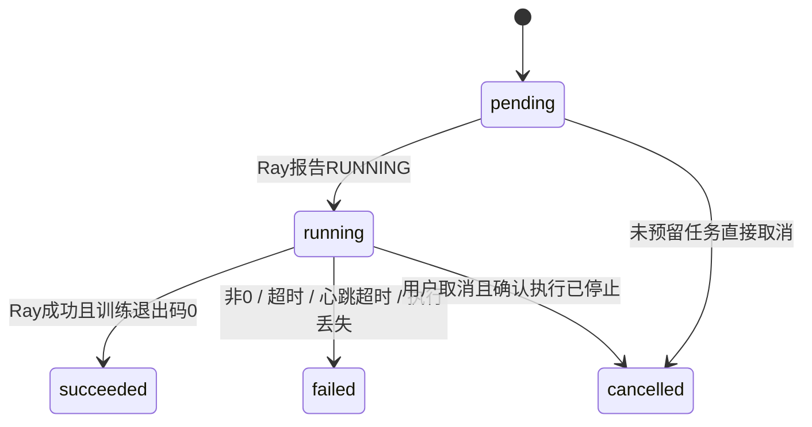
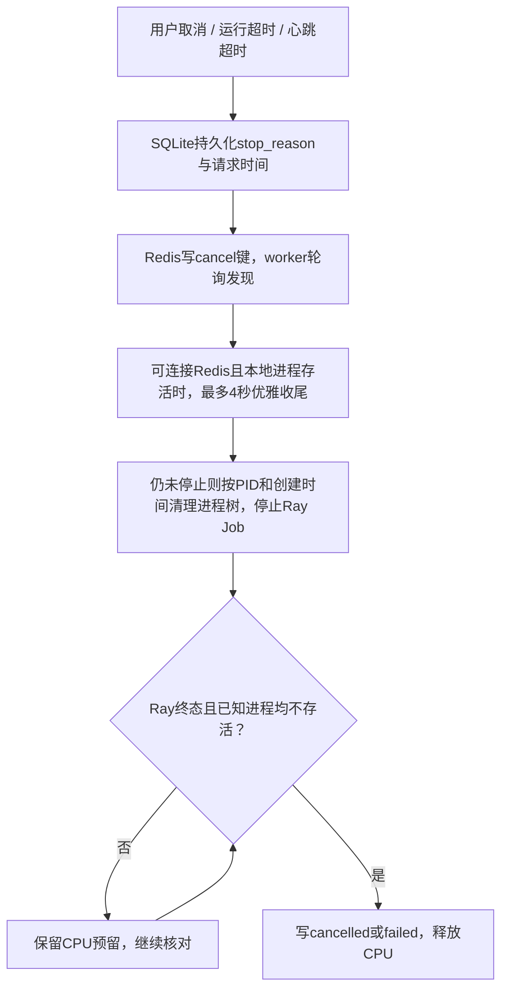
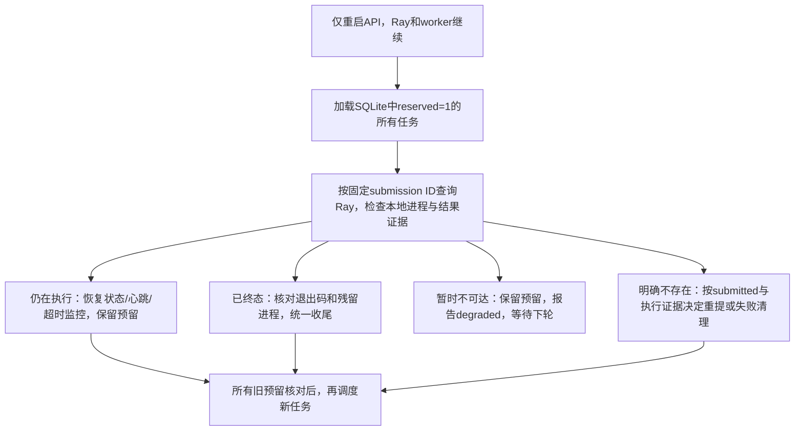
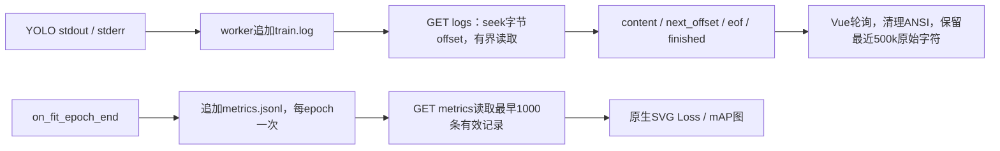

# TrainPlane：整体架构、功能实现与优化空间

答辩阅读版 · 以当前仓库实际代码及2026-11-01的Docker验收记录为准。仓库地址以README为准，参见 [项目README](../README.md)。

本文件把流程图、功能解释、代码入口、验收证据和改进建议放在一起。另有同内容的 [离线HTML阅读版](architecture-and-implementation.html)：双击即可阅读，图可缩放、横向滚动，支持打印，不依赖CDN。

**一句话说明：平台保存用户的训练意图，调度器分配CPU，Ray执行独立worker，worker管理YOLO子进程；平台持续核对真实执行状态，确认停止后才释放资源。**

## 目录

- [1. 已实现范围与运行边界](#s1)
- [2. 总体架构与组件分工](#s2)
- [3. 提交、排队与调度](#s3)
- [4. 状态机与内部控制字段](#s4)
- [5. CPU、心跳和超时控制](#s5)
- [6. 取消与进程树清理](#s6)
- [7. 重启恢复与提交不确定性](#s7)
- [8. 日志和训练指标链路](#s8)
- [9. 持久化结构与文件说明](#s9)
- [10. HTTP接口与参数](#s10)
- [11. 四个前端页面](#s11)
- [12. P0、P1与P2对照](#s12)
- [13. 实测证据与演示顺序](#s13)
- [14. 优化空间与适用条件](#s14)

<a id="s1"></a>
## 1. 已实现范围与运行边界

| 维度 | 当前事实 |
|---|---|
| 技术栈 | Python 3.12、FastAPI、Ray Jobs、Redis、SQLite；Vue3、Vite、TypeScript、Element Plus；ultralytics YOLO与CPU版PyTorch |
| 稳定交付路径 | Windows宿主运行浏览器、Node前端和Docker Desktop；Linux容器运行Ray、API、Redis和训练 |
| 默认规模 | 一个Ray节点、一个API调度进程，总CPU配额2；真实训练默认申请2，短测试任务可各申请1 |
| 训练负载 | yolov8n、coco128、CPU、1 epoch、imgsz=320、batch=1、workers=0、cache=False |
| 自研部分 | 四页UI、接口、任务记录、业务队列、状态机、心跳/超时策略、日志协议、恢复与验收脚本 |
| Ray承担部分 | 作业执行、入口逻辑CPU资源预留、执行状态、停止能力；使用Python Jobs SDK，允许的封装方式 |
| 禁用能力 | 不使用GPU、NCCL、DDP，不嵌入第三方训练平台页面；Ray Dashboard仅用于诊断 |
| 访问边界 | 宿主端口绑定127.0.0.1，面向可信本地单用户；没有公网多租户鉴权或命令沙箱 |
| 原生Windows路径 | 留有排查脚本，但Ray多轮运行曾出现GCS请求挂起，不将历史短测当作稳定交付结论 |

这套实现追求单机可解释、可复现的训练管理闭环。后文标为“建议”的内容没有混算成已实现功能。

<a id="s2"></a>
## 2. 总体架构与组件分工



| 组件 | 具体职责 | 代码入口 |
|---|---|---|
| FastAPI | 参数校验、提交/查询/取消/资源/日志/指标接口；生命周期启动调度器 | {{src:backend/app/main.py|lifespan}}、{{src:backend/app/main.py|JobCreate}} |
| 调度器 | 每秒检查依赖，先核对所有已有预留，再挑选待执行任务；管理业务状态和CPU账本 | {{src:backend/app/scheduler.py|Scheduler.tick}} |
| SQLite | 持久化任务意图、状态、时间、CPU预留、固定Ray提交ID | {{src:backend/app/store.py|initialize}}、{{src:backend/app/store.py|connection}} |
| Redis | worker短期心跳和取消信号；不作为任务历史的唯一存储 | {{src:backend/app/worker.py|main}}中的heartbeat_loop |
| Ray Jobs | 以独立于API的执行服务运行worker，为入口声明CPU，不再嵌套申请另一份Ray训练CPU | {{src:backend/app/scheduler.py|Scheduler.submit}} |
| worker | 启动训练子进程、合并stdout/stderr写日志、上报心跳、监督退出和后代清理 | {{src:backend/app/worker.py|main}}、{{src:backend/app/worker.py|stop_tree}} |
| 训练入口 | 固定CPU和coco128，应用线程配额、采集每epoch指标、保存模型 | {{src:backend/app/train.py|main}} |
| Vue页面 | 查询真实API，展示资源、任务、日志、指标，不生成假任务数据 | [路由](../frontend/src/router.ts)、[API客户端](../frontend/src/api.ts) |

部署由 [compose.yaml](../compose.yaml) 描述：前端5173、API8000、Ray Jobs HTTP8265、Redis6379；Ray内部GCS使用6380，避免与Redis混淆。API容器经服务名访问 `http://ray:8265` 与 `redis://redis:6379/0`。

**共享PID命名空间是当前单机清理方案的关键。** API使用 `pid: service:ray`，与Ray容器看到同一套Linux PID；两者使用同一镜像、同一 `/app` 路径，并挂载 `backend/data` 到 `/app/data`。因此API重启后仍能核对worker和训练PID的创建时间，执行兜底清理。模型 `backend/yolov8n.pt` 只读挂载。共享PID不是完整的任务安全隔离，多用户生产环境应换用独立执行代理或每任务容器。

<a id="s3"></a>
## 3. 提交、排队与调度



1. `POST /api/jobs` 校验后只写SQLite，快速返回201。训练不在HTTP请求线程里同步执行。
2. `Scheduler.dispatch()` 用 `BEGIN IMMEDIATE` 取得SQLite写事务，在同一事务中统计 `reserved=1` 的CPU总量、选择队列、标记预留并保存提交ID。
3. 排序为 `priority DESC, created_at, id`。优先级0～10，数字越大越优先；同优先级先提交先选。队首不够资源时停止本轮挑选，不做后续小任务回填，不抢占运行任务。
4. 固定提交ID为 `{job_id}-1`。当前没有自动重试，因此没有第二次attempt编号；“任务”和“执行尝试”的文件层级已经分开。
5. SQLite事务提交后才调用外部Ray。调用异常时保留预留并记录“提交不确定”，下一轮按同一ID核对，不能立即释放CPU再盲目提交。
6. 调度循环始终先核对所有旧预留，再放行新任务。`finish()`统一把状态、结束时间和 `reserved=0` 一起写回数据库。

代码：{{src:backend/app/main.py|create_job}}、{{src:backend/app/scheduler.py|Scheduler.dispatch}}、{{src:backend/app/scheduler.py|Scheduler.submit}}、{{src:backend/app/scheduler.py|Scheduler.finish}}。

**并发边界：** 调度与取消共用一个 `threading.RLock`；数据目录还有进程级文件锁，拒绝第二个调度器。演示使用一个Uvicorn worker且不启用reload。SQLite账本事务与Ray执行并非一个分布式事务；固定ID和对账降低重复执行风险，但不宣称跨所有崩溃场景的全局“恰好一次”。重复调用创建接口也没有业务幂等键，会创建不同任务。

<a id="s4"></a>
## 4. 状态机与内部控制字段



| 对外状态 | 意义与判断依据 |
|---|---|
| pending | 已保存，正在排队或等待执行器开始；此时可能已经预留CPU，不能仅凭状态判断CPU是否空闲 |
| running | Ray已报告RUNNING；worker和训练初始化可能还未完成，`started_at`可暂时为空 |
| succeeded | Ray终态SUCCEEDED，且训练结果或Ray驱动退出码确认为0；提交成功不算训练成功 |
| failed | 非0退出、运行超时、心跳超时、启动后未上报心跳或执行器明确丢失等；`error`说明原因 |
| cancelled | 用户取消；已预留任务必须等到确认停止后才释放，取消请求本身不是最终状态 |

内部用 `reserved`、`submitted`、`running_seen_at`、`stop_requested_at` 辅助控制，不增加题目之外的对外状态。`stop_reason`可返回给前端，页面显示“正在停止”并禁用重复取消。尚未真正启动的已预留pending任务也走停止确认流程，所以它可以最终成为cancelled或failed。

取消接口先检查Ray是否已经终态；若任务实际已经成功，会先收尾成功，避免过晚取消覆盖结果。终态任务再次取消保持不变。更细的跨请求完成竞态仍按平台已持久化的停止意图和对账结果处理，不依赖前端标签推断。

代码：{{src:backend/app/scheduler.py|Scheduler.request_cancel}}、{{src:backend/app/scheduler.py|Scheduler.reconcile}}、{{src:backend/app/main.py|public}}。

<a id="s5"></a>
## 5. CPU、心跳和超时控制

### CPU控制的三层关系

| 层次 | 当前实现 | 不应混淆的概念 |
|---|---|---|
| 平台账本 | 总量默认2；可用量=总量−所有未释放预留CPU | 预留核数不是瞬时CPU利用率 |
| Ray与Docker | `entrypoint_num_cpus=job.cpu`，GPU=0；Ray `--num-cpus` 与Compose `cpus` 均读取TOTAL_CPUS | Ray是逻辑调度；Docker限制Ray容器整体CPU时间，不是每任务独占物理核 |
| 训练线程 | worker设置OMP/MKL/OpenBLAS等线程环境；训练设置Torch intra-op配额、interop=1；训练/验证回调再次恢复线程数 | Ultralytics设备选择会重设线程，单在导入前设置一次不足 |

默认两份1核短任务可以并发，一份2核真实训练占满配额，其余等待。训练与验证均固定 `device=cpu`，隐藏CUDA，Ray不申请GPU；没有NCCL或DDP流程。

代码：[Compose资源配置](../compose.yaml)、{{src:backend/app/scheduler.py|Scheduler.submit}}、{{src:backend/app/train.py|main}}中的enforce_cpu_threads回调。

### 心跳与依赖故障

| 参数/信号 | 默认行为 |
|---|---|
| worker心跳周期 | 每2秒，独立线程执行；同时检查取消键 |
| Redis心跳键 | `heartbeat:{submission_id}`，值为Unix时间，TTL30秒 |
| 常规心跳超时 | 已收到过心跳后，超过15秒未更新判定失联；不是等TTL30秒才判断 |
| 首次心跳宽限 | Ray RUNNING后首次心跳最多等待90秒，覆盖初始化阶段 |
| Redis恢复宽限 | Redis恢复后的前4秒暂缓心跳超时判断，让worker有机会续报 |
| 本地辅助文件 | heartbeat.json保存最后心跳，便于排查；当前调度判断主要读取Redis并保存到SQLite |
| Redis不可用 | 不将依赖故障当作全部worker死亡；暂停新任务调度、保留预留，运行中的worker继续训练并尝试重连 |

心跳证明监督worker仍能上报，不直接证明模型训练正在取得进展；训练死循环但worker还活着时，最大运行时长负责兜底。调度器每秒检查，实际判定延迟还包括调度周期与外部请求耗时。

### 最大运行时长

worker从子进程实际启动后使用 `time.monotonic()` 计时，每约0.2秒检查；调度器使用保存的 `started_at` 与 `time.time()` 再次检查。排队时间不计入运行超时，Ray报告RUNNING但训练尚未启动时由首次心跳宽限约束。超时最终为failed，不是succeeded或用户cancelled。

worker的单调时钟避免普通系统时间校正影响进程内计时；调度器和跨进程心跳仍使用墙上时间，时钟跳变/长时间休眠是后续可靠性优化点。Ray HTTP调用由 `BoundedJobClient` 设置连接2秒、读取5秒超时，避免一次执行器请求永久卡死调度循环。

代码：{{src:backend/app/worker.py|main}}、{{src:backend/app/scheduler.py|Scheduler.reconcile}}、{{src:backend/app/scheduler.py|BoundedJobClient._do_request}}、[默认配置](../backend/app/config.py)。

<a id="s6"></a>
## 6. 取消与进程树清理



- **未预留的排队任务：** 可直接标记cancelled，未启动执行器，也没有CPU需要回收。
- **已预留任务：** 先保存停止意图，再尝试Redis取消；取消键为 `cancel:{submission_id}`，TTL3600秒。正常worker主动清理、写结果并退出。
- **宽限边界：** 只有Redis可用且已知进程仍活着时等待最多4秒；Redis故障或需要兜底时直接进入本地清理与Ray停止流程，并非任何情况下都固定等4秒。
- **避免误杀：** worker与调度器都记录PID和创建时间，防止PID复用。worker约每0.2秒发现后代，保存到process.json；父进程提前退出后仍有已知子进程身份可清理。
- **执行侧清理：** `stop_tree()`先terminate，等待最多3秒，再kill并再等待；finally仍执行清理并原子写result.json。异常或非0退出不能变成成功。
- **确认后回收：** 调度器看到Ray的SUCCEEDED/FAILED/STOPPED终态后，还要确认所有已记录本地进程消失。存在残留就继续清理，不先释放CPU。Ray明确任务不存在的恢复分支则先清理本地证据，确认不存活再失败/取消收尾。

这解释了为什么点击“取消”后页面可能短暂仍显示running或pending：停止请求已接收，资源还在等待真实停止确认。清理覆盖已发现和已记录的进程树；瞬时逃逸进程、恶意任意命令不属于安全沙箱保证，生产建议见第14节。

代码：{{src:backend/app/scheduler.py|Scheduler.request_cancel}}、{{src:backend/app/scheduler.py|stop_local}}、{{src:backend/app/scheduler.py|local_alive}}、{{src:backend/app/worker.py|matching_process}}、{{src:backend/app/worker.py|stop_tree}}。

<a id="s7"></a>
## 7. 重启恢复与提交不确定性



**先记意图、再做外部动作。** CPU预留和固定提交ID先落库，Ray提交随后发生。若Ray接受后响应丢失，下一轮查询同一ID就能接管已有任务；不会为每次网络重试生成新ID。

**明确不存在不等于暂时访问失败。** 连接超时等异常保留预留；只有Ray明确返回不存在时才进入丢失分支。`submitted=0`、无停止意图、无process/result证据且无存活进程时，才可按原ID再提交。若已有执行证据，不把任务当全新任务重跑；清理确认后失败或取消，并记录“Ray中任务已不存在”。

API重启后调度器逐一对账，资源账本来自持久化 `reserved`，不是重启就重置为0。API文件锁防止同目录同时有两个调度器。共享PID命名空间使Docker API容器重启后仍可核对原Ray训练进程。

恢复的是任务记录、资源预留和管理能力，**不承诺Ray容器/整机重启后自动断点续训**。模型权重留在磁盘，但自动resume、训练attempt重试目前未实现。某个任务对账异常可能中止这一轮后续处理；下一轮继续，此单调度器串行策略适合演示规模。

代码：{{src:backend/app/scheduler.py|Scheduler.tick}}、{{src:backend/app/scheduler.py|Scheduler.reconcile}}、[恢复验收脚本](../scripts/recovery.py)。

<a id="s8"></a>
## 8. 日志和训练指标链路



### 日志协议

每次执行有独立train.log，worker以二进制追加、无缓冲合并stdout/stderr。API使用 `seek(offset)` 后读取有限字节，不通过Ray接口一次拉取全量历史日志。

| 字段/参数 | 语义 |
|---|---|
| offset | 从0开始的文件字节位置，不是字符数；必须非负 |
| limit | 默认65536字节，即64KiB；最小4，最大1048576字节，即1MiB |
| content | 该段UTF-8文本；边界处完整字符才交给客户端 |
| next_offset | 真正消耗的字节数加旧offset，前端必须直接使用此值 |
| eof | 本次读到当前文件末尾；运行中的文件后续还可能增长 |
| finished | 业务任务已经终态；前端仅在finished且eof时停止取日志 |

UTF-8尾部若跨读取边界，或运行中暂时只写入半个字符，API暂不消费残尾，下一次继续读取。终态遗留非法字节用替换字符展示。offset大于已有文件长度返回416，日志尚未生成返回空内容。日志文件不会在当前实现中自动轮转或截断。

详情页每1.5秒轮询。前端保留最近 **500,000个原始JS字符**，之后才做ANSI转义序列清理和回车归一化，因此这是字符缓存上限，不是500KB、不是完整日志下载，也不是虚拟滚动。暂停只停止自动滚到底部，仍继续取日志；复制的是清理后的当前显示内容，发生截断时页面明确提示。内容用Vue文本插值渲染，不作为HTML执行。

路由切换时使用generation标识丢弃旧请求结果，避免A任务日志混到B任务；同一轮未完成时不重入；任务结束后读完尾部再停止日志获取。通用API客户端对请求设置15秒Abort超时。

代码：{{src:backend/app/main.py|logs}}、[JobDetail.vue的poll/displayLogs/toggleFollow/copyLogs](../frontend/src/views/JobDetail.vue)、[api.ts](../frontend/src/api.ts)。当前没有SSE或WebSocket日志流。

### 指标采集与展示

训练入口的 `on_fit_epoch_end` 回调提取box/cls/dfl loss与mAP，过滤非有限数，以 `{epoch,timestamp,metrics}` 追加到metrics.jsonl。用进程内已记录epoch集合去重，避免最终最佳模型验证再次回调造成同epoch重复。

`GET /api/jobs/{id}/metrics` 将原始键名映射为统一字段。当前从头读取并返回最早 **1000条有效指标记录**，无epoch游标、无分页、无下采样，超出部分不会在本接口显示；这不是“最近1000条”。详情页每4轮获取一次指标，正常约6秒一次，SVG组件提供Loss/mAP切换。1 epoch时只有一个点，不能展示长期收敛趋势。

**已有指标持久化与GET读取，没有指标POST存储接口。** worker/训练入口直接写本机共享文件。这满足本项目选做的指标采集与可视化部分，不能包装成完整外部指标上报服务。

代码：{{src:backend/app/train.py|main}}中的save_metrics、{{src:backend/app/main.py|metrics}}、[MetricChart.vue](../frontend/src/components/MetricChart.vue)。

<a id="s9"></a>
## 9. 持久化结构与文件说明

### SQLite jobs表

| 字段 | 用途 |
|---|---|
| id / name / command | 平台任务ID、展示名、可信本地执行命令 |
| cpu / timeout_seconds / priority | CPU申请、最大实际运行时长、调度优先级 |
| status | pending/running/succeeded/failed/cancelled |
| created_at / started_at / finished_at | 提交、训练子进程启动、平台收尾时间；数据库保存Unix时间，API返回UTC ISO字符串 |
| heartbeat_at | 已观察的最近worker心跳，持久化便于恢复与页面查看 |
| exit_code / error | 训练结果或Ray驱动退出码，以及失败/取消说明 |
| ray_submission_id | 唯一固定执行ID；用于不确定提交对账与文件目录关联 |
| reserved | CPU是否仍被此任务占用/预留，是资源账本依据 |
| submitted | 已明确提交给Ray，或对账确认Ray已有该任务 |
| stop_reason / stop_requested_at | 停止原因和持久化请求时间，用于取消/看门狗与优雅宽限 |
| running_seen_at | 首次看到Ray RUNNING时间，用于首次心跳宽限 |

数据库启用WAL、busy_timeout=10000ms，每次操作使用独立连接并提交/回滚。调度预留使用 `BEGIN IMMEDIATE`；API读查询可与WAL写操作协作。动态更新字段名由应用内部固定调用产生，用户查询值使用SQL占位符；ID搜索还转义LIKE通配符。

### 文件树

```text
backend/data/                         # 宿主持久化目录；容器内/app/data
  platform.sqlite3                   # 任务、时间、状态、资源预留
  scheduler.lock                     # 单调度器文件锁
  datasets/coco128/                   # 预缓存的128张图和标注
  ultralytics/                       # 本机运行设置与可选Arial字体缓存
  jobs/{job_id}/{submission_id}/
    config.json                      # 名称、命令、CPU、运行时限
    process.json                     # worker/训练PID、创建时间、已发现后代
    heartbeat.json                   # 辅助排查心跳；判断主要用Redis
    train.log                        # 独立stdout+stderr持续追加
    result.json                      # 退出码、完成时间、错误和进程身份
    metrics.jsonl                    # 每epoch追加记录
    coco128.yaml                     # 预缓存存在时生成，数据集path为容器内绝对路径
    artifacts/train/weights/          # best.pt、last.pt
```

process/result/heartbeat等JSON通过临时文件、flush、fsync、replace原子替换，读者不会看到一半JSON；日志和指标使用追加，不是一份全量内存字符串。数据库和运行数据、模型、缓存均不进Git，安装与预缓存脚本负责复现；Redis启用AOF并使用持久卷，但业务历史仍以SQLite为准。

### 源文件导航

| 路径 | 主要入口 |
|---|---|
| [backend/app/main.py](../backend/app/main.py) | lifespan、JobCreate及全部HTTP路由 |
| [backend/app/config.py](../backend/app/config.py) | DATA、Redis/Ray地址、CPU、心跳和调度默认值 |
| [backend/app/store.py](../backend/app/store.py) | initialize、connection、get、update |
| [backend/app/scheduler.py](../backend/app/scheduler.py) | start/tick/dispatch/submit/reconcile/request_cancel/finish、进程核对、HTTP超时 |
| [backend/app/worker.py](../backend/app/worker.py) | main、write_json、matching_process、stop_tree |
| [backend/app/train.py](../backend/app/train.py) | CPU训练、绝对数据集YAML、线程回调、指标回调 |
| [backend/app/demo.py](../backend/app/demo.py) | 确定性短任务、非0退出和心跳冻结故障注入 |
| [compose.yaml](../compose.yaml) / [Dockerfile](../backend/Dockerfile) | Linux执行服务、共享PID、挂载、端口和CPU上限 |
| [frontend/src](../frontend/src) | router、api、4页与SVG图表组件 |
| [scripts](../scripts) | 安装、预缓存、启停、smoke、并发、恢复验收 |
| [backend/tests](../backend/tests) | 业务边界与真实worker进程树测试 |

<a id="s10"></a>
## 10. HTTP接口与参数

| 方法与路径 | 实现说明 | 源码 |
|---|---|---|
| GET /api/health | Ray、Redis及最近调度错误；依赖或调度异常时degraded | {{src:backend/app/main.py|health}} |
| GET /api/cluster | 总/已预留/可用CPU、排队与运行数、单节点CPU/内存瞬时利用率 | {{src:backend/app/main.py|cluster}} |
| POST /api/jobs | 校验并保存任务，返回201；资源不足不拒绝，而是排队 | {{src:backend/app/main.py|create_job}} |
| GET /api/jobs | page默认1、page_size默认10且1～100；状态精确筛选、ID子串搜索；提交时间倒序 | {{src:backend/app/main.py|list_jobs}} |
| GET /api/jobs/{id} | 配置、状态、时间、心跳、Ray ID、退出码与错误 | {{src:backend/app/main.py|detail}} |
| POST /api/jobs/{id}/cancel | 接收取消意图，返回当前状态；终态幂等保持 | {{src:backend/app/main.py|cancel}} |
| GET /api/jobs/{id}/logs | byte offset有界读取，返回下一位置、当前EOF和任务结束标志 | {{src:backend/app/main.py|logs}} |
| GET /api/jobs/{id}/metrics | 从JSONL读取并映射每epoch指标，最多最早1000条有效记录 | {{src:backend/app/main.py|metrics}} |

提交体示例：

```json
{"name":"YOLO CPU 演示","command":"python -m app.train --epochs 1 --imgsz 320 --batch 1","cpu":2,"timeout_seconds":1800,"priority":0}
```

name长度1～100、command长度1～4096，去空白后不得为空；cpu为正整数且不超过平台总量；timeout_seconds为1～86400，priority为0～10。未知任务404，参数错误422，日志offset超界416。前端API客户端统一处理错误提示。没有任务删除、失败重试、文件下载、SSE、指标POST、登录注册或Webhook路由。

集群接口的psutil瞬时指标是Docker Linux节点整体观察值，不是每任务CPU/内存采样，也不能当作资源可分配量；可分配量始终由预留账本计算。

<a id="s11"></a>
## 11. 四个前端页面

| 页面 | 实现内容 | 请求与交互 |
|---|---|---|
| /overview 集群总览 | CPU总配额、已分配、可用、排队卡片；配额环图；节点表与实际CPU/内存进度条；最近任务 | 每3秒查询cluster和最近5条任务，并发请求、busy防重入 |
| /jobs 任务列表 | 五种状态标签、ID搜索、状态筛选、每页10/20/50、详情/日志/取消 | 每3秒刷新；筛选回第一页；序号防旧响应覆盖；终态和停止中禁用取消 |
| /submit 任务提交 | 内置CPU训练命令，名称/命令/CPU/时限/优先级，资源快照和可能排队提示 | Element Plus校验，提交按钮loading，成功跳转列表；资源快照只是提示，调度时重新判断 |
| /jobs/:id 详情与日志 | 配置、状态、时间、心跳、退出码与错误、终端日志、自动滚动开关、复制、Loss/mAP图 | 详情/日志1.5秒，指标约6秒；generation防跨任务串流；500k原始字符缓冲；结束且EOF停止日志读取 |

代码：[Overview.vue](../frontend/src/views/Overview.vue)、[Jobs.vue](../frontend/src/views/Jobs.vue)、[Submit.vue](../frontend/src/views/Submit.vue)、[JobDetail.vue](../frontend/src/views/JobDetail.vue)、[MetricChart.vue](../frontend/src/components/MetricChart.vue)、[StatusBadge.vue](../frontend/src/components/StatusBadge.vue)。Vite将 `/api` 代理到宿主127.0.0.1:8000；页面和后端分开运行。

终端采用深色视觉，但没有整站深色主题开关。当前没有浏览器任务状态通知、日志关键词高亮或虚拟滚动；ANSI清理是可读性处理，不等于这些P1特性。路由当前静态导入、Element Plus整包注册，首包优化属于后续建议。

<a id="s12"></a>
## 12. P0、P1与P2对照

| 层级 | 已实现/设计范围 | 边界 |
|---|---|---|
| P0 后端 | 提交、分页、详情、取消、资源、增量日志；CPU排队/回收；五状态；心跳；运行超时；日志/元数据持久化；API重启对账 | 单节点、单调度器，SSE可选项未做 |
| P0 前端 | 四个页面及列表筛选分页、提交跳转、状态标签、日志暂停滚动/复制 | 使用真实API，完整日志仍在服务器 |
| P1 优先级 | priority降序、同级FIFO | 没有抢占、回填或aging；持续高优先级输入可能使低优先级长期等待 |
| P1 指标 | 每epoch JSONL持久化、GET读取、SVG Loss/mAP | 没有指标POST存储接口、游标或长期指标服务 |
| 其他P1 | 未实现自动重试、单用户CPU配额、任务进程CPU/内存定时采样、关键词高亮、浏览器通知、整站深色模式、日志虚拟滚动 | 节点瞬时psutil数据、取消进程身份记录、前端轮询重试都不能冒充这些功能 |
| P2 多节点 | 设计：Ray多节点资源与worker代理，日志/产物迁移共享存储 | 未编码 |
| P2 流水线 | 设计：预处理→训练→评估步骤依赖，每步单独资源与attempt | 未编码 |
| P2 数据集/模型管理 | 已有固定coco128预缓存及本地权重；设计未来版本化数据集、对象存储和下载授权 | 没有完整管理页面或权重下载API |
| P2 Webhook | 设计：事务outbox、签名、幂等、退避和死信 | 未编码 |

完整P2口述提纲见 [design-p2.md](design-p2.md)。选做与高阶设计不替代P0验收，也不把未实现项列为已完成。

<a id="s13"></a>
## 13. 实测证据与演示顺序

### 已发生的验收，不新增测试宣称

| 证据 | 实际结果 |
|---|---|
| [yolo-results.json](yolo-results.json) | Docker真实YOLO任务993c67aa8de849fa；1 epoch、320、batch1、CPU2；107.378161秒，succeeded、exit0；四次训练/验证线程检查均2，日志无下载 |
| 同一真实训练指标 | box_loss1.69865、cls_loss3.8395、dfl_loss1.49486、mAP50 0.38557、mAP50-95 0.26747；best.pt/last.pt各6491754字节；结束后allocated0/available2 |
| [verification.md](verification.md) | Linux单元与真实worker测试14 passed、无skip、12.98秒；测试涉及状态/资源、Redis故障、UTF-8、取消竞态、提交不确定性及真实后代清理；这里引用已有执行记录，不声称本文件重新运行了测试 |
| [smoke-results.json](smoke-results.json) | HTTP九项通过：依赖/资源、队列取消、实际运行取消及自动接续、UTF-8增量、exit7、运行超时、心跳超时、筛选分页、资源回收 |
| [concurrency-results.json](concurrency-results.json) | 两个1核任务均实际启动且有心跳，第三个排队；分配不超过2，全部成功并回收 |
| [recovery-results.json](recovery-results.json) | 仅重启API容器；Ray容器ID/StartedAt不变，worker2218、训练2220及创建时间相同；日志启动一次；队列接续成功，51.515秒，最终资源全空闲 |
| [browser-results.json](browser-results.json) | 网页真实提交YOLO成功、筛选、分页、ID搜索、中文日志、暂停/复制、ANSI清理、运行任务取消及资源回收 |
| [页面截图](screenshots/overview.png) | 同目录包含overview、jobs、submit、detail、detail-map五张实测图片 |

本机为i5-8265U、4物理核8线程、约8GB内存。测量时经用户授权临停其他15个Docker应用以释放资源；107.378秒不是所有原有应用共存时的性能，也不是跨机器承诺。coco128训练/验证共用小样本，本次指标用于验证链路，不能当作模型泛化精度基准。

### 可复现操作入口

```powershell
.\scripts\setup.ps1
backend\.venv\Scripts\python.exe scripts\prepare_training.py --mirror
.\scripts\start-docker.ps1 -Build
# 平台空闲时依次验收：
backend\.venv\Scripts\python.exe scripts\smoke.py
backend\.venv\Scripts\python.exe scripts\concurrency.py
backend\.venv\Scripts\python.exe scripts\recovery.py --docker
```

setup默认仅为宿主安装requests/psutil及前端依赖；训练栈在Docker镜像内。预缓存脚本的模型镜像传输验证官方SHA256，coco128来源为Ultralytics的Kaggle数据集，来源和摘要见 [training-assets.json](training-assets.json)。Arial仅从本机字体复制到被忽略的运行目录。原生排查需要 `setup.ps1 -Native`，但不推荐作为稳定演示路径。

建议答辩顺序：先总览讲清两核配额；网页提交默认YOLO；看日志/指标与资源释放；再用短任务演示排队、取消、超时、失联；最后只重启API说明恢复。短任务验证控制逻辑，不替代真实训练。

<a id="s14"></a>
## 14. 优化空间与适用条件

以下是生产化或规模增长建议，**不是把未实现的选做项误写为P0缺失**。顺序按可靠性到体验组织；A表示向公网或多人使用前优先，B表示任务规模/数据增长时，C表示体验与效率优化。

| 顺序 / 方向 | 当前边界 | 建议与触发条件 | 建议级别 |
|---|---|---|---|
| 1 可靠性 | 单循环串行对账，HTTP已有超时；SQLite与Ray不是同一事务；创建接口无幂等键；协调侧使用墙上时间 | 增加客户端幂等键、持久提交阶段/事件、故障分类与带抖动退避；独立健康/进度探针；测试时钟跳变与存储中断。扩大规模前再考虑更严格执行租约，不能仅给固定ID就承诺恰好一次 | A/B |
| 2 安全 | 可信单用户可输入命令，无鉴权；API共享Ray PID且可清理进程，shell=False也不是沙箱 | 公网前加入身份/权限、命令模板白名单、最小权限worker、网络/挂载限制、审计；用受控执行代理替换跨租户共享PID，防止用户任务读取其他任务或宿主数据 | A |
| 3 内存与任务隔离 | Docker总CPU上限与Torch线程控制；没有每任务内存/PID上限、任务级RSS曲线；已知进程树清理有发现窗口 | 多用户/大训练采用每任务容器/cgroup内存与PID限制、CPU配额、进程生命周期绑定，采集RSS/CPU；先做低成本资源预检，OOM与超时区分原因 | A/B |
| 4 调度公平性 | 严格优先级/FIFO，无回填、aging或抢占，队首可能阻塞，低优先级可能饥饿 | 加等待时间提升优先级，或在资源预留不被侵蚀的前提下安全回填；确有业务需求再引入配额、公平队列及检查点抢占 | B |
| 5 单调度器扩展 | RLock+文件锁+SQLite适合单机；共享PID只适合同节点 | 任务量或多API实例增长时拆独立调度器，迁移事务数据库，带fencing token的选主/租约，节点执行代理与对象存储；不可直接把Uvicorn workers调大 | B |
| 6 指标游标 | GET每次从头读最早1000条，没有POST接口；长训练后半段不可见 | 按epoch/记录游标增量读取，区分attempt与指标版本；需要远端worker时增加带认证的批量上报、幂等去重、分辨率下采样或专门存储 | B |
| 7 日志归档 | 文件无限追加，按物理byte offset读取；前端只留500k字符，没有虚拟滚动 | 配保留策略、磁盘配额、归档压缩及授权下载；轮转时引入分片ID+逻辑游标，不能直接截断导致旧offset失效；大面板再加虚拟滚动或SSE | B/C |
| 8 依赖与镜像锁定 | 固定核心Python版本并保存Linux依赖快照；基础镜像/Redis标签仍可变化，首次需下载 | 用完整Linux锁文件、镜像digest、受信制品缓存与校验摘要复现；构建时做兼容检查，形成固定版本升级/回滚流程 | B |
| 9 前端首包与轮询 | 静态路由导入、Element Plus整包；固定1.5/3秒轮询，终态后详情仍轮询；错误时没有指数退避 | 路由懒加载、组件按需引入/分包；隐藏标签页降频、终态停掉不必要请求、错误指数退避和请求去重；只有需要更低延迟时才加SSE | C |

答辩可这样解释取舍：先用单机、单调度器和真实训练完成全部P0；可靠停止和可恢复账本优先于增加复杂功能。后续改进由用户数量、任务规模、数据量与安全边界驱动，不为演示预先堆叠完整生产平台。
